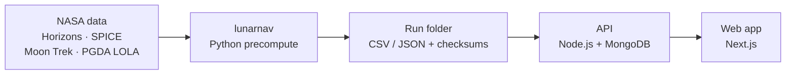

# Lunar Landing Site Navigator: backend & data

**Team Moon Plan B · NASA Space Apps Challenge 2026**

Ranks lunar south-pole landing sites by how long they see the **Sun** (power) and the **Earth** (radio link),
using the real terrain horizon of each site and NASA data.

| | |
|---|---|
| 🌐 Web app | https://lunavigator.com |
| 🔌 Live API | https://api.lunavigator.com/api/v1/health (other routes need an API key) |
| 📄 License | [MIT](LICENSE) · [third-party notices](THIRD_PARTY_NOTICES.md) |
| 🤖 AI use | [docs/AI_DISCLOSURE.md](docs/AI_DISCLOSURE.md) |

## What it does

- **Sunlight:** % of time the Sun is above the terrain, longest night, solar-power proxy.
- **Earth link:** % of time the Earth is visible, longest communication gap.
- **Ranking:** compare 23 catalog sites (or any coordinate) for 2026–2030, hour by hour.
- **Landing dates:** if the launch slips, find later dates that still give enough sun and Earth contact.

## How it works



1. `lunarnav` computes Sun/Earth positions and each site's terrain horizon, then visibility hour by hour.
2. The results are checked (`lunarnav check`) and imported into the API.
3. The web app (`frontend/` in the team repo) reads them through the API.

## NASA data used

| Source | Used for |
|---|---|
| [JPL Horizons](https://ssd.jpl.nasa.gov/horizons/) | Sun and Earth positions (run A) |
| [NAIF SPICE kernels](https://naif.jpl.nasa.gov/pub/naif/generic_kernels/) | Sun and Earth positions (run B) |
| [NASA Moon Trek](https://trek.nasa.gov/moon/) LOLA DEMs | Terrain (run A) |
| [NASA GSFC PGDA](https://pgda.gsfc.nasa.gov/products/90) LOLA DEMs | Terrain (run B, default) |
| [PGDA illumination maps](https://pgda.gsfc.nasa.gov/products/69) · [LROC QuickMap](https://quickmap.lroc.asu.edu/) | Validation |

## Validated

- Horizons vs SPICE: Sun/Earth directions agree to **0.002″**.
- Permanently shadowed craters: **0 %** sunlight at all 30 test pixels, as in NASA's PGDA map.
- Well-lit sites vs NASA's PGDA map: median difference **3.9 percentage points**.
- 8 cases re-checked by hand in Horizons, QuickMap and Moon Trek: [NASA_TOOLS_CROSSCHECK.md](docs/NASA_TOOLS_CROSSCHECK.md).

Details: [VALIDATION.md](docs/VALIDATION.md) · [VALIDATION_TERRAIN.md](docs/VALIDATION_TERRAIN.md)

## How it meets the judging criteria

| Criterion | Our answer |
|---|---|
| **Impact** | Mission planners, lander teams, educators and students see in seconds how many hours a site gets sunlight (power) and Earth contact (radio): the two things that decide whether a lander survives. Moving 100 m on the Shackleton–de Gerlache ridge can drop sunlight from 85 % to 20 %; the tool shows this before a site or date is fixed. Open source (MIT) with a public API. |
| **Creativity** | Sun **and** Earth visibility together, from real terrain, every hour for 5 years. A "Plan B" date finder for launch slips. Two independent pipelines (Horizons + Moon Trek vs SPICE + PGDA) check each other. Plain-language panel and antenna pointing. |
| **Validity** | Real physics: apparent Sun/Earth positions, terrain horizon out to 150 km, lunar curvature, 2 m mast. Checked against NASA: Horizons vs SPICE 0.002″, 0 % sun in all 30 shadowed-crater test pixels, median 3.9 points vs NASA illumination maps, hand checks in Horizons, QuickMap and Moon Trek. 441 Python and 426 API tests. Every run is reproducible (checksums in `manifest.json`). Limits are stated (±1 h timing, DEM resolution). |
| **Relevance** | Answers the challenge directly: compare sites and dates, show the Sun and Earth against the horizon, assess power and direct-to-Earth comms. NASA data are the core input: Horizons, Moon Trek and QuickMap from the challenge Resources, plus NASA GSFC PGDA and NAIF SPICE. |
| **Presentation** | Live web app (https://lunavigator.com), live API, this short README and the step-by-step guide. |

## Run it locally

Needs Python ≥ 3.10, Node.js ≥ 24, MongoDB 8 (e.g. `docker run -d -p 27017:27017 mongo:8`).

```bash
cd lunar-navigator

# 1. Python package
python3 -m venv .venv && source .venv/bin/activate      # Windows: .\.venv\Scripts\Activate.ps1
pip install -e ".[dev]"

# 2. API with the sample data shipped in the repo
cd backend
npm ci
cp .env.example .env                                     # Windows: Copy-Item .env.example .env (dev mode: no API key)
npm run import -- tests/fixtures/sample_2026Q1_spice_pgda --default
npm run dev
```

Then open http://127.0.0.1:8000/api/v1/health and the API docs at http://127.0.0.1:8000/docs.

Step-by-step guide (Windows commands, tests, your own runs, API keys): [docs/RUN_LOCALLY.md](docs/RUN_LOCALLY.md)

## Folders

| Folder | Contents |
|---|---|
| `lunarnav/` | Python package and CLI (`lunarnav precompute`, `analyse`, `alt-dates`, `check`) |
| `backend/` | Node.js API, OpenAPI contract, tests, deploy scripts ([README](backend/README.md)) |
| `notebooks/` | Google Colab notebook for the full 5-year runs ([README](notebooks/README.md)) |
| `docs/` | Documentation ([architecture](docs/ARCHITECTURE.md), [output format](docs/OUTPUT_SPEC.md), [sites](docs/SITES.md), [data sources](docs/DATA_SOURCES.md)) · `docs/vi/`: team notes in Vietnamese |
| `tests/` | Python tests |

## AI use

Built with help from Anthropic's Claude (Claude Code), which wrote most of the code and docs under the team's
direction. All numbers come from deterministic code run on NASA data, not from an AI model.
[Details](docs/AI_DISCLOSURE.md)

## License & credits

MIT © 2026 Nguyen Trong Chung and the Moon Plan B team. Data: NASA/JPL, NASA GSFC PGDA, NASA Moon Trek, LROC/ASU.
No NASA logos are used and NASA has not endorsed this project. Full list: [THIRD_PARTY_NOTICES.md](THIRD_PARTY_NOTICES.md).

Backend & data: Nguyen Trong Chung, Institute of Aerospace Technology, VNU University of Engineering and Technology, Hanoi.
