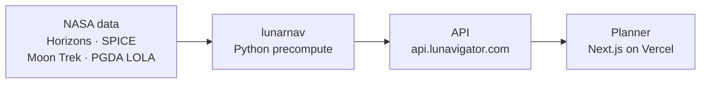

# Moon Plan B: Lunar Landing Site Navigator

**NASA Space Apps Challenge 2026 · challenge "Lunar Landing Site Navigator"**

Compare how long the **Sun** and **Earth** are visible from a lunar landing site. In [run B2](frontend/public/data/run-b2/catalog.json), 18 sites use a terrain horizon and five use a flat horizon outside terrain coverage. Visibility alone does not predict solar power, radio quality or lander survival.

| | |
|---|---|
| 🗺️ Planner (web app) | https://moon-plan-b.vercel.app/plan |
| 📊 Data browser | https://moon-plan-b.vercel.app/data |
| 🌐 Project page | https://lunavigator.com |
| 🔌 Live API | https://api.lunavigator.com/api/v1/health (other routes need an API key) |

## What it does

Open **Explore the landing sites** on the homepage for the orbit view. Choose Athena or Odysseus, switch weeks, then look toward the Sun or Earth from the selected site. The four site-level views and both weekly comparisons work without the live API. The instant inspector on the comparison page can also show modeled rise/set times and coverage limits.

- **Compare sites or dates:** % of time with sunlight, with Earth in view, and with both, for 23 sites, every hour of 2026–2030.
- **See the sky:** the Sun and Earth against the site’s modeled horizon, in 2D tracks and a 3D sky view, on an interactive globe.
- **Plan B dates:** if a launch slips, find later landing times that still give enough sun and Earth contact.
- **Explain and share:** English/Vietnamese interface, an "Ask the astronaut" guide, CSV downloads, shareable links, printable reports.

## How it works



1. **`lunarnav`** computes Sun/Earth positions and a local terrain horizon where data are available (out to 150 km), then visibility hour by hour.
2. The **API** (Node.js + MongoDB) serves the results and computes custom sites and landing dates on demand.
3. The **planner** (Next.js) shows comparisons, sky views and timelines from the API.

## NASA data used

| Source | Used for |
|---|---|
| [JPL Horizons](https://ssd.jpl.nasa.gov/horizons/) | Sun and Earth positions |
| [NASA Moon Trek](https://trek.nasa.gov/moon/) LOLA DEMs | Lunar terrain where covered |
| [LROC QuickMap](https://quickmap.lroc.asu.edu/) | Cross-checking heights and illumination |
| [NASA GSFC PGDA](https://pgda.gsfc.nasa.gov/products/90) LOLA DEMs and [illumination maps](https://pgda.gsfc.nasa.gov/products/69) | Terrain (default dataset) and validation |
| [NAIF SPICE kernels](https://naif.jpl.nasa.gov/pub/naif/generic_kernels/) | Independent check of Sun/Earth positions |
| [NASA SVS Moon imagery](https://svs.gsfc.nasa.gov/4720/) | Globe in the planner |

## How it meets the judging criteria

| Criterion | Our answer |
|---|---|
| **Impact** | Mission planners, lander teams, educators and students see in seconds the modeled hours of sunlight and Earth visibility. In the [C1 validation case](lunar-navigator/docs/VALIDATION_TERRAIN.md), a 100 m shift northeast reduced the modeled 18.6-year mean illumination from about 85% to 20% at 2 m observer height. |
| **Creativity** | Sun **and** Earth visibility together, from real terrain, every hour for 5 years. A "Plan B" landing-date finder for launch slips, a 3D sky view, a bilingual astronaut guide, and two independent computation pipelines that check each other. |
| **Validity** | Real physics: apparent positions, terrain horizon out to 150 km, lunar curvature, 2 m mast. Checked against NASA: Horizons vs SPICE within 0.002″, 0 % sunlight in all 30 shadowed-crater test pixels, median 3.9 points vs NASA illumination maps, hand checks in Horizons, QuickMap and Moon Trek. Hundreds of automated tests; every run is reproducible with checksums. |
| **Relevance** | Answers the challenge directly: compare sites and dates, show the Sun and Earth against the horizon, identify when each is visible, a starting point for separate power and radio analyses. The three tools from the challenge Resources (Horizons, Moon Trek, QuickMap) are core inputs. |
| **Presentation** | A live planner anyone can open, a public data browser, and short documentation. |

## Repository

| Folder | Contents |
|---|---|
| [`frontend/`](frontend/) | Next.js planner ([README](frontend/README.md)) |
| [`lunar-navigator/`](lunar-navigator/) | Python computation (`lunarnav`) and the API ([README](lunar-navigator/README.md)) |
| [`contracts/`](contracts/) · [`docs/`](docs/) · [`qa/`](qa/) | API contracts, frontend docs, QA checks |

## Run it locally

```bash
# Planner (Node 24)
cd frontend && npm ci --ignore-scripts && npm run dev

# Computation + API (Python ≥ 3.10, Node 24, MongoDB 8)
cd lunar-navigator   # then follow lunar-navigator/README.md
```

Details: [frontend/README.md](frontend/README.md) · [lunar-navigator/docs/RUN_LOCALLY.md](lunar-navigator/docs/RUN_LOCALLY.md)

## AI use

The team chose the challenge, data and methods and checked the results. AI assistants wrote much of the code and docs:
OpenAI Codex for the frontend ([credits](docs/CREDITS.md)), Anthropic Claude for the computation and API
([disclosure](lunar-navigator/docs/AI_DISCLOSURE.md)). All scientific numbers come from deterministic code run on NASA data.

## License & credits

`lunar-navigator/`: [MIT](lunar-navigator/LICENSE). Frontend and other files: see [docs/CREDITS.md](docs/CREDITS.md).
Data: NASA/JPL, NASA GSFC PGDA, NASA Moon Trek, LROC/ASU, NASA SVS ([full list](lunar-navigator/THIRD_PARTY_NOTICES.md)).
No NASA logos are used and NASA has not endorsed this project.

Team process: [AGENTS.md](AGENTS.md) · [HANDOFF.md](HANDOFF.md)
