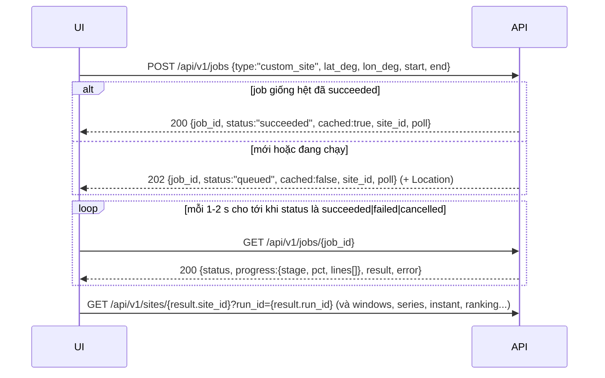

# Tích hợp Frontend (Next.js) với backend lunarnav

> Dành cho dev FE của **Lunar Landing Site Navigator** (NASA Space Apps 2026). Đọc file này là đủ để gọi API;
> chi tiết từng field nằm trong spec OpenAPI. Ngày viết: 14-11-2026, API `v1` (`api_version` 1.0.0).

| Bạn cần | Ở đâu |
|---|---|
| **Contract** (nguồn sự thật duy nhất) | `backend/contract/openapi.json` (OpenAPI 3.1.0). Server đang chạy cũng phục vụ `GET /api/v1/openapi.json` và Swagger UI ở `/docs` |
| **Response mẫu thật** (chụp từ API thật trên dữ liệu mẫu 2026-Q1, 6 site) | `backend/contract/examples/*.json|csv|txt` + `index.json` (request, status, header của từng mẫu) |
| **Code mẫu copy được** (types sinh từ spec + client `openapi-fetch` + hook TanStack Query + `next.config` rewrites + URL state) | `backend/fe-starter/` |
| Định dạng dữ liệu gốc của Python | `docs/OUTPUT_SPEC.md` |

> **API key:** server public (`https://api.lunavigator.com`) yêu cầu header `X-API-Key` trên mọi route `/api/v1` trừ
> `GET /api/v1/health`. Key chỉ nằm trong env **phía server** của Next.js (`LUNARNAV_API_KEY`), trình duyệt gọi qua
> route handler proxy. Xem **mục 15. Xác thực (API key)**.

Dữ liệu mẫu dùng trong mọi ví dụ: run `pf_21c3f3f6dc56b1e1` (SPICE + PGDA + raymarch), 2026-01-01 → 2026-04-01 theo giờ
(2160 mẫu), 6 site: `ref_connecting_ridge_c1`, `ref_shackleton_rim`, `a3_haworth`, `a3_de_gerlache_rim_2`,
`apollo11`, `change6`. Run thật (23 site × 2026–2030) có **cùng hình dạng**, chỉ khác `run_id` và độ dài.

---

## 1. Bắt đầu nhanh (10 phút)

```bash
# 0) Lấy contract: copy backend/contract/openapi.json vào repo FE (ví dụ ./contract/openapi.json),
#    hoặc tải từ server: curl -o contract/openapi.json http://127.0.0.1:3000/api/v1/openapi.json
#    (server có DOCS_USER/DOCS_PASSWORD, ví dụ https://api.lunavigator.com: thêm  -u <docs_user>:<docs_password>)

# 1) Mock server từ spec (không cần backend, không cần MongoDB) -> http://127.0.0.1:4010
npx -y @stoplight/prism-cli@5.15.11 mock -h 127.0.0.1 -p 4010 contract/openapi.json

# 2) Types + client có type
npm i openapi-fetch@0.17.0 @tanstack/react-query@5
npm i -D openapi-typescript@7.13.0
npx openapi-typescript contract/openapi.json -o src/lib/api/schema.d.ts --default-non-nullable false

# 3) Copy từ backend/fe-starter/: src/lib/api/client.ts, src/lib/api/queries.ts, src/lib/url-state.ts,
#    phần rewrites của next.config.ts, env.local.example -> .env.local
#    .env.local:  API_INTERNAL_URL=http://127.0.0.1:4010   (mock)  hoặc  http://127.0.0.1:3000 (backend thật)
#                 LUNARNAV_API_KEY=<key>   (chỉ khi backend bật API key; KHÔNG BAO GIỜ đặt NEXT_PUBLIC_*), xem mục 15
#    + src/app/api/lunar/[...path]/route.ts (proxy phía server thêm X-API-Key)
```

Ghi chú:
- Prism 5.16 cần Node ≥ 24.18 → dùng đúng **5.15.11** (chạy được trên Node ≥ 24.14).
- openapi-typescript 7.13 có peer `typescript ^5` → project Next.js dùng TS 5.x (đã kiểm với 5.9.3).
- `--default-non-nullable false`: field request có giá trị mặc định ở server vẫn là **optional** trong type.
- Chạy backend thật trên máy dev (cần MongoDB local, xem `backend/README.md`): `cd backend && npm run dev` →
  http://127.0.0.1:3000/api/v1/health, docs http://127.0.0.1:3000/docs.

---

## 2. Quy ước (áp dụng cho MỌI endpoint)

### 2.1 Chung
| Quy ước | Chi tiết |
|---|---|
| Base path | `/api/v1`. Mọi path trong spec đã có sẵn `/api/v1` → `baseUrl` của client chỉ là **origin** (`''`, `http://127.0.0.1:3000`). |
| Tên field | **snake_case**, giống hệt OUTPUT_SPEC (`sun_el_deg`, `pct_sun`, `longest_dark_h`…). Áp dụng cho cả query param. `GET /meta` trả `field_case: "snake_case"`. |
| Thời gian | Chuỗi ISO 8601 **UTC có `Z`**, độ phân giải giây: `2026-03-14T05:30:00Z`. Gửi lên cũng phải đúng dạng này (không offset `+07:00`, không bỏ `Z`, không ms). Hiển thị giờ địa phương là việc của FE; dữ liệu luôn UTC. |
| Khoảng thời gian | Luôn `[start, end)`: **`end` exclusive**. Server *snap* `start` xuống và `end` lên lưới mẫu (1 h) rồi **echo lại** giá trị thật đã dùng trong response → vẽ theo giá trị echo, không theo giá trị đã gửi. Khoảng chỉ chồng một phần với run → bị cắt (clamp); không chồng chút nào → `422 OUT_OF_RANGE`. |
| `run_id` | Query **tuỳ chọn** ở mọi GET dữ liệu; bỏ trống = run mặc định (`is_default`, xem `GET /health` → `default_run_id` hoặc `GET /runs`). Dạng `pf_<16 hex>` (precompute import) hoặc `job_<job_id>` (toạ độ tuỳ chỉnh). |
| `site_id` | Id catalog (`a3_haworth`) hoặc id custom canonical `custom:<lat 4 số>:<lon 4 số>` (`custom:-89.4500:222.6900`). **Có dấu `:` → luôn `encodeURIComponent()` khi đặt vào path** (openapi-fetch tự làm). |
| Provenance | Mọi response dữ liệu có `run_id`, `step_s` (3600) và `precision_h` (= step_s/3600 = 1). Mọi ranh giới cửa sổ và mọi giá trị "còn bao nhiêu giờ" chính xác **± `precision_h` giờ**. |
| Thiếu dữ liệu | `null` (không bao giờ `NaN`/chuỗi rỗng trong JSON). Trong CSV: ô rỗng. |
| Danh sách trong query | Phân cách bằng dấu phẩy: `fields=sun_el_deg,earth_el_deg`, `kinds=sun,earth`, `weights=pct_sun:0.4,pct_earth:0.3,pct_both:0.3`. |
| Query/body **strict** | Tham số lạ → `400 VALIDATION_ERROR` (`unrecognized_keys`). Ví dụ gõ nhầm `kind=` thay vì `kinds=` sẽ bị từ chối (xem `examples/error_unknown_param.json`), không bị lờ đi. |
| Lỗi | Mọi lỗi là `application/problem+json` (RFC 9457) với `code` ổn định → §5. |
| Dữ liệu thật | Mọi route đọc MongoDB (không còn stub; header `x-lunarnav-stub` đã bỏ). `POST /alt-dates` có header `x-lunarnav-cache: hit | miss | shared`. Giá trị API = file Python bit-for-bit (test `backend/tests/crosscheck`). |

### 2.2 Đơn vị và quy ước vật lý
| Đại lượng | Đơn vị / miền | Ghi chú |
|---|---|---|
| Vĩ độ `lat_deg` | độ, [-90, 90] | planetocentric |
| Kinh độ `lon_deg` | độ **East**, [0, 360) | 222.69 E = -137.31 (W). Khi tạo job có thể gửi giá trị âm (W), server đổi về [0, 360). GeoJSON: `coordinates = [lon_east, lat]`. |
| Azimuth `*_az_deg`, `az_deg` | độ, [0, 360), **theo chiều kim đồng hồ từ hướng Bắc địa phương** (về phía cực Bắc Mặt Trăng): N=0, E=90, S=180, W=270 | như JPL Horizons. Ở gần cực Nam, "Bắc" gần như là mọi hướng nhìn ra khỏi cực. |
| Elevation `*_el_deg` | độ trên mặt phẳng vuông góc bán kính cầu địa phương | không khí quyển, không khúc xạ; giá trị **tâm** đĩa. Horizon địa hình có thể < 0 (dip). |
| `*_clearance_deg` | độ | `el − horizon_el` tại azimuth của thiên thể (tâm đĩa) |
| `sun_fraction`, `earth_fraction` | 0..1 | phần đĩa nằm trên đường chân trời địa hình |
| `sun_visible` | bool | **mép trên** đĩa Mặt Trời trên horizon địa hình (`sun_fraction > 0`) |
| `earth_visible` | bool | `earth_clearance_deg > min_earth_clearance_deg` (thường 0) = có thể liên lạc trực tiếp với Trái Đất (DTE) |
| `power_horizontal`, `power_tracking`, `mean_power_*` | 0..1 (tương đối) | panel nằm ngang / panel bám Mặt Trời. Nhân 100 nếu muốn hiện %. |
| `irradiance_tracking_wm2` | W/m² | 0..~1420 (1361 W/m² ở 1 AU) |
| `*_dist_km` | km | |
| `pct_*` (`pct_sun`, `pct_earth`, `pct_both`, `pct_sun_no_earth`), `sun_pct`… | **phần trăm 0..100** (không phải 0..1) | theo thời gian trong khoảng |
| `score` | 0..100 | tổng có trọng số của các `pct_*` (mặc định 0.4·sun + 0.3·earth + 0.3·both) |
| `*_h` (`longest_dark_h`, `duration_h`, `hours_until.*`, `slip_h`, `mission_h`) | **giờ** | ± `precision_h` |
| `*_truncated`, `lower_bound` | bool | `true` = chạm biên run/khoảng → giá trị chỉ là **cận dưới** ("≥ 326 h") |
| `map.x_km`, `map.y_km` | km | chiếu cực Nam stereographic (cầu R = 1737.4 km, như bản đồ LOLA); `map: null` với site ở bắc 60°S (Apollo, far side) |
| `bin_s`, `step_s` | giây | |

Danh sách đầy đủ field series kèm đơn vị, kiểu, nullable, mô tả: `GET /api/v1/meta` → `series_fields` (mẫu:
`examples/meta.json`). Nên dựng legend/tooltip từ đây thay vì hardcode. `GET /meta` cũng có `limits`
(max_points, số site compare, giới hạn job, rate limit) và `default_rank_weights`, `site_groups`
(`south_pole`, `reference`, `apollo`, `far_side`), `alt_date_objectives`.

### 2.3 Cửa sổ (windows)
`state: true` = thấy (có nắng / thấy Trái Đất / cả hai); `false` = tối / mất liên lạc. `start` = mẫu đầu của cửa sổ,
`end` = mẫu đầu của cửa sổ kế tiếp (exclusive). Chuyển trạng thái thật nằm trong `(start − step, start]`.
- `truncated_start/end`: cửa sổ chạm **biên run** → độ dài thật dài hơn hoặc không biết.
- `clipped_start/end`: cửa sổ bị cắt bởi **khoảng truy vấn** của bạn (khác `truncated_*`).
- Vẽ dải timeline từ `windows` (hoặc `events` của `/series`), **không** suy ra từ series đã downsample.

---

## 3. Bảng endpoint

Mọi path có tiền tố `/api/v1`. "Mẫu" = file trong `backend/contract/examples/`.

| # | Method + path | operationId | Dùng cho UI | Mẫu |
|---|---|---|---|---|
| 1 | `GET /health` | getHealth | trạng thái API, mongo, python, `default_run_id` | `health.json` |
| 2 | `GET /meta` | getMeta | enum + giới hạn + danh sách field/đơn vị | `meta.json` |
| 3 | `GET /runs?kind=&status=&limit=&offset=` | listRuns | chọn run, "về dữ liệu" | `runs.json`, `runs_ready.json` |
| 4 | `GET /runs/{run_id}` | getRun | provenance đầy đủ (manifest, data sources) | `run_detail.json` |
| 5 | `GET /sites?run_id=&group=&format=json\|geojson` | listSites | danh mục + marker bản đồ; `geojson` → `application/geo+json` (Point + Polygon vùng Artemis) | `sites.json`, `sites_south_pole.json`, `sites_geojson.json` |
| 6 | `GET /sites/{site_id}?run_id=` | getSite | thẻ site: record, extra, metrics toàn khoảng, rank/score, `warnings[]` | `site_detail.json`, `site_detail_apollo11.json` |
| 7 | `GET /sites/{site_id}/horizon` | getSiteHorizon | silhouette chân trời (720 điểm, bước 0.5°) | `horizon.json` |
| 8 | `GET /sites/{site_id}/series?start=&end=&fields=&max_points=&agg=sample\|minmax` | getSiteSeries | đường cong timeline (dạng cột) + `events` chuyển trạng thái chính xác | `series_week.json`, `series_minmax.json` |
| 9 | `GET /sites/{site_id}/instant?t=` | getSiteInstant | readout tại thanh trượt thời gian | `instant.json` |
| 10 | `GET /sites/{site_id}/sky?start=&end=&max_points=` | getSiteSky | sky diagram: vệt Sun/Earth (az/el) + horizon | `sky.json` |
| 11 | `GET /sites/{site_id}/windows?start=&end=&kinds=sun,earth,both` | getSiteWindows | dải timeline | `windows.json`, `windows_march_sun_earth.json` |
| 12 | `POST /compare` | compareSites | so sánh 2–4 site trên một khoảng ngày | `compare.json` |
| 13 | `GET /ranking?group=&start=&end=&weights=` | getRanking | bảng xếp hạng (+ `reasons[]` cho tooltip) | `ranking.json`, `ranking_custom_weights.json` |
| 14 | `POST /alt-dates` | findAltDates | "lịch trượt": ngày hạ cánh thay thế (Python, đồng bộ ≤ 30 s, có cache) | `alt_dates.json` |
| 15 | `POST /jobs` | createJob | tính toạ độ tuỳ chỉnh (bất đồng bộ) → `202` | `job_accepted.json` |
| 16 | `GET /jobs/{job_id}` | getJob | polling tiến độ | `job.json` |
| 17 | `DELETE /jobs/{job_id}` | cancelJob | huỷ job (chỉ gỡ client của bạn; job dùng chung vẫn chạy cho client khác, xem §6) | `job_cancelled.json` |
| 18 | `GET /jobs/{job_id}/events` | streamJobEvents | SSE tiến độ (tuỳ chọn; polling mới là contract) | `job_events.txt` |
| 19 | `GET /sites/{site_id}/export/series.csv?start=&end=&fields=` | exportSiteSeriesCsv | nút tải CSV | `export_series.csv` |
| 20 | `GET /sites/{site_id}/export/windows.csv?start=&end=&kinds=` | exportSiteWindowsCsv | nút tải CSV | `export_windows.csv` |
| 21 | `GET /export/summary.csv?run_id=` | exportSummaryCsv | tải bảng tổng hợp | `export_summary.csv` |
| 22 | `GET /runs/{run_id}/files/{file_path}` | getRunFile | tải file gốc precompute; `file_path` URL-encode (`sites%2Fapollo11%2Fwindows.json`), phải có trong manifest; `ETag` + `304` | (chỉ trong `index.json`) |

Ngoài spec: `GET /api/v1/openapi.json` (spec), `/docs` (Swagger UI).
Nếu bản `openapi.json` bạn đang có chưa có `/sky` hoặc `events`/`next_events`, hãy xin bản mới (hoặc tải
`/api/v1/openapi.json` từ server dev) rồi sinh lại types.

### 3.1 Ví dụ (rút gọn từ file mẫu thật)

**`GET /api/v1/sites?group=south_pole`** (`sites_south_pole.json`)
```json
{"run_id":"pf_21c3f3f6dc56b1e1","step_s":3600,"precision_h":1,
 "sites":[{"id":"a3_de_gerlache_rim_2","name":"Artemis III region: de Gerlache Rim 2","group":"south_pole",
   "origin":"catalog","lat_deg":-88.222637,"lon_deg":296.565051,
   "map":{"projection":"south_polar_stereographic_R1737.4km","x_km":-48.21,"y_km":24.105},
   "dem_source":"pgda:bands[LDEM_80S_20MPP_ADJ<15km,...]","horizon_method":"raymarch",
   "rank":4,"score":35.12963,"pct_sun":41.851852,"pct_earth":49.027778,"pct_both":12.268519,
   "longest_dark_h":430,"longest_comms_gap_h":352}]}
```

**`GET /api/v1/sites/apollo11`** → giống thẻ site bình thường, nhưng có cảnh báo phải hiển thị:
```json
"warnings":["smooth-sphere horizon (dem_source none:outside-pgda-coverage)","flat horizon: terrain shadowing not modelled"]
```

**`GET /api/v1/sites/ref_connecting_ridge_c1/series?start=2026-03-01T00:00:00Z&end=2026-03-08T00:00:00Z&fields=sun_el_deg,earth_el_deg,sun_visible,earth_visible`**
```json
{"run_id":"pf_21c3f3f6dc56b1e1","step_s":3600,"precision_h":1,"site_id":"ref_connecting_ridge_c1",
 "start":"2026-03-01T00:00:00Z","end":"2026-03-08T00:00:00Z","bin_s":3600,"n":168,"agg":"sample",
 "fields":{"sun_el_deg":[-0.594478,-0.595312,"..."],"earth_el_deg":["..."],"sun_visible":[true,"..."],"earth_visible":["..."]},
 "events":[{"t":"2026-03-03T09:00:00Z","kind":"earth","state":false}]}
```
- Dạng **cột**, thời gian ngầm định: điểm `i` ở `start + i * bin_s`.
- Số mẫu > `max_points` (mặc định 2000, tối đa 5000) → server tự chọn `bin_s` = bội của `step_s`.
  `agg=sample`: giá trị đầu mỗi bin. `agg=minmax`: mỗi field thành `{"min":[…],"max":[…]}`, field bool thành tỉ lệ
  true 0..1 (vẽ dải min–max). Mẫu: `series_minmax.json` (2160 mẫu → 90 bin, `bin_s` 86400).
- `events`: các chuyển trạng thái chính xác (đầu cửa sổ) **trong** khoảng, kể cả khi đã downsample.
- Tối đa 8 field; vượt → `400 TOO_MANY_POINTS` (có `hint`).

**`GET /api/v1/sites/{id}/windows?start=2026-03-01T00:00:00Z&end=2026-04-01T00:00:00Z&kinds=sun,earth`**
```json
{"run_id":"pf_21c3f3f6dc56b1e1","step_s":3600,"precision_h":1,"site_id":"ref_connecting_ridge_c1",
 "start":"2026-03-01T00:00:00Z","end":"2026-04-01T00:00:00Z",
 "sun":[{"start":"2026-03-01T00:00:00Z","end":"2026-03-29T00:00:00Z","duration_h":672,"state":true,
         "truncated_start":true,"truncated_end":false,"clipped_start":true,"clipped_end":false}, "..."],
 "earth":[{"start":"2026-03-01T00:00:00Z","end":"2026-03-03T09:00:00Z","duration_h":57,"state":true, "...":"..."}]}
```
Chỉ có các key đã xin trong `kinds` (mặc định cả 3: `sun`, `earth`, `both`). `duration_h` là độ dài **sau khi cắt**.

**`GET /api/v1/sites/{id}/instant?t=2026-03-14T05:30:00Z`** (`instant.json`)
```json
{"t":"2026-03-14T05:30:00Z","sample_utc":"2026-03-14T05:00:00Z","sample_index":1733,
 "sun":{"az_deg":11.454255,"el_deg":0.14242,"horizon_el_deg":-0.499418,"clearance_deg":0.641838,"fraction":1,
        "visible":true,"power_horizontal":0.002486,"power_tracking":1,"irradiance_tracking_wm2":1380.858,"dist_km":148518305.766},
 "earth":{"az_deg":132.467647,"el_deg":-5.401922,"horizon_el_deg":-1.952841,"clearance_deg":-3.449082,"fraction":0,"visible":false,"dist_km":396348.989},
 "both_visible":false,
 "hours_until":{"sunset":355,"sunrise":0,"earthset":0,"earthrise":61},
 "next_events":{"sunset":{"hours":354.5,"at":"2026-03-29T00:00:00Z","state_now":true,"lower_bound":false}, "...":"..."}}
```
- Giá trị đọc từ mẫu `sample_utc` = mẫu ≤ `t` (giữ nguyên trong 1 giờ).
- `hours_until.*`: tính từ `sample_utc` (cột precompute). `next_events.*`: tính từ chính `t` → **nên hiển thị
  `next_events`** cho thanh trượt. `0` = điều kiện đang đúng (ví dụ `sunrise: 0` = đang có nắng).
  `null` / `lower_bound: true` = không xảy ra trước cuối run → hiện "> X h" hoặc "không trong khoảng dữ liệu".

**`GET /api/v1/sites/{id}/sky?start=…&end=…&max_points=…`** (`sky.json`): `horizon` (silhouette đầy đủ, như `/horizon`)
+ `sun`/`earth` = `{t[], az_deg[], el_deg[], visible[], decimated, n_transitions}`. Vệt đã được tỉa (giữ cực trị độ cao
và hai mẫu quanh mỗi lần chuyển trạng thái) nên `t` **không đều** → vẽ theo `t` thật, không theo index.

**`POST /api/v1/compare`**
```json
{"site_ids":["ref_connecting_ridge_c1","a3_haworth","apollo11"],
 "start":"2026-01-01T00:00:00Z","end":"2026-04-01T00:00:00Z",
 "weights":{"pct_sun":0.4,"pct_earth":0.3,"pct_both":0.3},
 "include":{"windows":["sun"],"series":{"fields":["sun_el_deg"],"max_points":24}}}
```
→ `{run_id, step_s, precision_h, range:{start,end,step_s,n_samples}, weights, ranking:[RankingRow…],
sites:{"<site_id>":{metrics, windows, series, warnings}}}` (`compare.json`). 2–4 site khác nhau; `run_id`, `start`,
`end`, `weights`, `include` đều tuỳ chọn. `metrics` = đủ bộ OUTPUT_SPEC §3.6 (schema `Metrics`).

**`GET /api/v1/ranking?group=south_pole&weights=pct_sun:0.7,pct_both:0.3`** → `{range, weights, source, ranking:[…]}`.
`source: "summary"` = toàn run + trọng số mặc định (giá trị nguyên văn của Python); `"computed"` = tính lại theo
khoảng/trọng số bạn gửi. Mỗi dòng có `reasons[]` (câu ngắn tiếng Anh cho tooltip) và cờ `*_truncated`.
Hoà điểm → `longest_dark_h` ngắn hơn đứng trước, rồi theo `site_id`.

**`POST /api/v1/alt-dates`** (`alt_dates.json`)
```json
{"site_id":"ref_connecting_ridge_c1","earliest":"2026-01-05T00:00:00Z","latest":"2026-02-20T00:00:00Z",
 "mission_h":336,"max_results":3,
 "constraints":{"min_sun_pct":70,"require_sun_at_landing":true,"require_earth_at_landing":true,"objective":"balanced"}}
```
→ `{cache_id, site_id, earliest_utc, latest_utc, mission_duration_h, constraints (đã điền mặc định), n_evaluated,
n_feasible, rejected_by:{<ràng buộc>: số ứng viên bị loại}, candidates:[{rank, landing_utc, mission_end_utc, slip_h,
score, sun_pct, earth_pct, both_pct, longest_dark_h, longest_comms_gap_h, continuous_sun_h, …}]}`.
- `candidates: []` vẫn là **200** → hiển thị `rejected_by` ("bị loại vì: require_earth_at_landing 649").
- Ứng viên luôn nằm trong `[earliest, latest]`. Server làm tròn `earliest` **lên** mẫu giờ kế tiếp và `latest`
  **xuống** mẫu giờ liền trước, rồi trả hai mốc đã làm tròn trong `earliest_utc` / `latest_utc`; `slip_h` tính từ
  `earliest_utc`. Ví dụ `05:00:00.500Z`..`06:00:00.750Z` → chỉ xét mẫu `06:00:00Z`. Giây lẻ và mili-giây được chấp nhận.
- `mission_h` phải là bội của bước run (1 h) → nếu không `422 BAD_MISSION_LENGTH`; `latest + mission_h` vượt cuối run
  → `422 OUT_OF_RANGE` kèm `max_latest` (đặt làm giới hạn date picker).
- Chậm hơn các GET (gọi Python, ~1–2 s; lần sau cùng tham số lấy từ cache). Rate limit 5 lần/phút/IP.

**Export CSV**: header là tên field snake_case, thời gian `time_utc` ISO Z, bool là `1`/`0`. Dùng
`<a href={downloadUrl(...)} download>` (helper trong `fe-starter/src/lib/api/client.ts`); server gửi
`Content-Disposition: attachment`.

---

## 4. Cache và header
- Dữ liệu precompute **bất biến theo `run_id`** → chỉ request **có `run_id`** mới cache lâu: server gửi
  `Cache-Control: public, max-age=3600`. Request **không có `run_id`** đọc run mặc định, run này đổi khi backend import
  run mới với `--default` → server gửi `public, max-age=60` (cho mọi data GET: sites, site, horizon, series, instant,
  sky, windows, ranking, CSV). `fe-starter` làm giống vậy (`staleTime` 1 h khi có `run_id`, 60 s khi không).
  Mẹo: lấy `run_id` từ response đầu tiên (`GET /sites`) rồi gửi kèm ở các request sau → cache lâu và nhất quán.
- `ETag` + `If-None-Match` → `304` (so sánh weak, nhận cả danh sách `"a", "b"`). `Vary: Origin, accept-encoding`.
- `GET /runs/{run_id}/files/{path}`: byte gốc, **không nén** (không có `Content-Encoding`), `ETag` = `"<sha256 trong
  manifest>"`, `Content-Type` theo đuôi file: `.json` → `application/json`, `.csv` → `text/csv`, `.csv.gz` →
  `application/gzip`, còn lại `application/octet-stream`.
- Header CORS cho phép đọc: `etag`, `location` (POST /jobs), `retry-after`, `x-ratelimit-limit|remaining|reset`,
  `x-lunarnav-cache` (alt-dates), `content-disposition`.
- Xác thực: header `X-API-Key` trên mọi route `/api/v1` trừ `GET /health` (spec: `securitySchemes.ApiKeyAuth`, `security`
  toàn cục; `getHealth` có `security: []`); thiếu/sai → `401 UNAUTHORIZED`. Xem mục 15.
- Rate limit: 300 request/phút; `POST /alt-dates` và `POST /jobs`: 5/phút. Tính **theo API key** (mọi request của một key,
  tức mọi người dùng của FE, chung một bucket); request không cần key (`/health`, dev không bật key) tính theo IP.

---

## 5. Lỗi: `application/problem+json` (RFC 9457)

```json
{"type":"https://lunarnav.example/errors/site-not-found","title":"Site not found","status":404,
 "code":"SITE_NOT_FOUND","detail":"site \"custom:-89.4500:222.6900\" is not in this run",
 "instance":"/api/v1/sites/custom%3A-89.4500%3A222.6900",
 "hint":"GET /api/v1/sites lists the site ids of a run; encodeURIComponent() ids that contain \":\""}
```
- **Luôn `switch` theo `code`** (ổn định, có trong type `Problem['code']`), không theo `title`/`detail` (tiếng Anh,
  có thể đổi câu chữ). `detail` dùng để log/hiện cho dev.
- `errors[]` (lỗi validate): `{path, in: "querystring"|"body"|"params", message, code}` → gắn lỗi vào đúng ô form
  theo `path` (ví dụ `start`, `constraints.min_sun_pct`, `fields.1`). Mẫu: `error_validation.json`.
- Có thể có thêm member: `hint`, `max_latest`, `min_earliest`, `retry_after_s`, `job_status`, `limits`,
  `max_active_per_client`, `max_streams_per_client`.
- Ngày giờ không có thật (giờ 25, tháng 13, 30/02) → `400 VALIDATION_ERROR` ở cả query lẫn body (`start`, `end`,
  `earliest`, `latest`), `errors[].path` = tên field.
- `weights` (ranking/compare): mỗi metric tối đa 1 lần, giá trị 0..1, **ít nhất một trọng số > 0**; số dạng
  `1e-7` được chấp nhận. Sai → `400 VALIDATION_ERROR` (`path: "weights"`). Helper `weightsParam()` ghi số thập phân ≤ 6 chữ số.

| HTTP | `code` | Khi nào | Gợi ý xử lý ở UI |
|---|---|---|---|
| 400 | `VALIDATION_ERROR` | query/body/path sai schema, tham số lạ | lỗi lập trình hoặc form: hiện `errors[]` cạnh ô nhập |
| 400 | `TOO_MANY_POINTS` | > 8 fields hoặc `max_points` > 5000 — ở `/series`, `/sky`, `/export/series.csv` **và** `include.series` của `POST /compare` | giảm field / max_points (đọc `GET /meta` limits) |
| 401 | `UNAUTHORIZED` | thiếu hoặc sai API key (cùng một body cho cả hai; header `WWW-Authenticate: ApiKey header="X-API-Key"`) | lỗi cấu hình server FE (`LUNARNAV_API_KEY`); không retry, log lại |
| 403 | `JOB_NOT_YOURS` | `DELETE /jobs/{id}` từ client (IP) chưa từng POST job đó | lỗi lập trình (job id của người khác) |
| 404 | `SITE_NOT_FOUND`, `RUN_NOT_FOUND`, `JOB_NOT_FOUND`, `FILE_NOT_FOUND` | id không tồn tại (run custom có thể **đã hết hạn**) | "không còn dữ liệu" + nút quay về run mặc định |
| 404 | `NOT_FOUND` | không có route, **kể cả sai method** (ví dụ `PUT /sites`; server không trả 405) | lỗi lập trình |
| 409 | `RUN_NOT_READY` | run đang import | thử lại sau vài giây |
| 409 | `JOB_NOT_CANCELLABLE` | huỷ job đã xong (`job_status`) | refetch job |
| 413 / 415 | `PAYLOAD_TOO_LARGE` / `UNSUPPORTED_MEDIA_TYPE` | body > 1 MiB / `Content-Type` không phải JSON (kể cả `text/plain`) | gửi `Content-Type: application/json` |
| 422 | `OUT_OF_RANGE`, `BAD_MISSION_LENGTH` | khoảng ngoài run, mission_h sai bội | dùng `max_latest`/`min_earliest` để chỉnh date picker |
| 429 | `RATE_LIMITED` | vượt rate limit (`Retry-After`, `retry_after_s`) | disable nút, đếm ngược |
| 429 | `QUEUE_FULL` | hàng đợi job đầy (20) | "server bận, thử lại sau" |
| 429 | `TOO_MANY_JOBS` | client (IP; IPv6 tính theo /64) đã có 2 job queued/running (`max_active_per_client`) | "chờ job đang chạy xong hoặc huỷ nó" |
| 429 | `TOO_MANY_STREAMS` | client đã mở 5 stream `GET /jobs/{id}/events` | đóng `EventSource` cũ, hoặc dùng polling |
| 500 | `INTERNAL` | lỗi server | thông báo chung + retry |
| 502 | `PYTHON_FAILED` | Python lỗi (alt-dates) | thông báo + retry |
| 503 | `SERVICE_UNAVAILABLE` | MongoDB không sẵn sàng | banner "dịch vụ tạm gián đoạn" |
| 504 | `PYTHON_TIMEOUT` | alt-dates quá 30 s | thu hẹp khoảng `earliest..latest` |

Job lỗi **không** trả HTTP lỗi: `GET /jobs/{id}` vẫn 200 với `status:"failed"` và `error:{code, message}`
(ví dụ `code: "SERVER_RESTARTED"` → cho người dùng bấm chạy lại).

`unwrap()` trong `fe-starter/src/lib/api/client.ts` biến mọi lỗi (kể cả lỗi mạng, trang HTML của proxy) thành
`ApiProblem` có `.code`, `.status`, `.problem` → TanStack Query đặt vào `error`.

---

## 6. Luồng job toạ độ tuỳ chỉnh (polling = contract)



1. Body tối thiểu: `{"type":"custom_site","lat_deg":-89.45,"lon_deg":222.69,"start":"2026-01-01T00:00:00Z","end":"2026-02-01T00:00:00Z"}`.
   Tuỳ chọn: `name`, `step_min` (chỉ 60), `provider` (`horizons` mặc định từ 14/11: JPL Horizons API online;
   `spice` = chạy offline bằng kernel trên server), `dem` (`pgda`, tải mảnh online khi cần), `horizon_method`
   (`raymarch`), `observer_height_m` (2). Hoặc `site_id` của catalog thay cho lat/lon (để tính khoảng ngày ngoài run).
   Khoảng tối đa 366 ngày.
2. Response trả ngay `site_id` canonical (`custom:-89.4500:222.6900`) → dùng làm key UI.
3. Poll `GET /jobs/{job_id}` mỗi **1.5 s** (hook `useJob` trong `fe-starter` đã làm, tự dừng khi xong).
   `progress.stage`: `queued` → `precompute` → `import` → `done`; `pct` có thể `null`; `lines` = các dòng log cuối của Python.
4. `succeeded` → `result: {run_id: "job_<id>", site_id}` → gọi **chính các endpoint bình thường** với
   `run_id=job_<id>`. Không cần nhánh code riêng.
5. Job dùng chung: gửi lại **cùng tham số** khi job đang chạy → nhận lại đúng job đó (202, `cached: true`) và client
   của bạn được **đăng ký** vào job (`Job.clients` = số client đang chờ; `params.name` = tên chính bạn gửi).
   Huỷ: `DELETE /jobs/{job_id}` chỉ gỡ **client của bạn** (client = IP). Nếu không còn ai chờ → job `cancelled`
   (Python bị kill). Nếu client khác vẫn chờ → job **tiếp tục chạy cho họ**: response 200 có `status` vẫn
   `queued`/`running` và `clients > 0` → UI của bạn coi như đã huỷ và **bỏ job id** (ngừng poll).
   `DELETE` từ client chưa từng POST job đó → `403 JOB_NOT_YOURS`.
   Mỗi client tối đa **2 job** queued/running (`429 TOO_MANY_JOBS`); đăng ký vào job đang chạy không tính là job mới.
6. Thời gian (đo trên máy dev): ~10 s cho 1 site × 1 tháng hoặc 1 năm khi tile DEM vùng đó đã có cache; **1–11 phút**
   lần đầu dùng một vùng cực mới (tải tile PGDA). → UI cần trạng thái "đang tính" có thể kéo dài vài phút.
7. Kết quả custom hết hạn sau 30 ngày (`expires_at`); job failed/cancelled chỉ giữ 24 h. Hết hạn → 404 → hiện thông báo.
8. SSE (tuỳ chọn): `GET /jobs/{job_id}/events` → `event: job` + `data: <Job JSON>` mỗi khi đổi, `: ping` mỗi 15 s,
   đóng stream sau trạng thái cuối (`new EventSource(url)`). Tối đa 5 stream mở cùng lúc mỗi client
   (`429 TOO_MANY_STREAMS`) → nhớ `close()` EventSource khi unmount. Polling vẫn là cách được đảm bảo.

---

## 7. Mock server (Prism)

```bash
npx -y @stoplight/prism-cli@5.15.11 mock -h 127.0.0.1 -p 4010 contract/openapi.json      # trả examples trong spec
npx -y @stoplight/prism-cli@5.15.11 mock -d -h 127.0.0.1 -p 4010 contract/openapi.json   # dữ liệu giả ngẫu nhiên
# trong repo backend: npm run mock
```
- Mock trả đúng các `examples` trong spec (lấy từ dữ liệu mẫu thật), cho mọi id/tham số hợp lệ.
- Khác biệt: request sai schema mà spec diễn tả được (kiểu, enum, pattern: ví dụ `fields=sun_el_deg,bogus`,
  `kinds=x`) → Prism trả **422** (header `sl-violations`); server thật trả **400 `VALIDATION_ERROR`**.
  Prism **không** bắt được: tham số query lạ (`?kind=sun` — server thật trả 400), ngày không có thật, trùng metric
  trong `weights`, tổng trọng số 0, giới hạn số field → test các lỗi này với server thật.
- `POST /jobs` trên mock: Prism chọn mã 2xx nhỏ nhất → **200** với ví dụ "cache hit" (`status: "succeeded"`,
  `cached: true`) — luồng hợp lệ, UI nhảy thẳng sang kết quả. Muốn thử luồng chờ: gửi header `Prefer: code=202`
  → `202 {status: "queued", cached: false}`. `GET /jobs/{id}` luôn trả cùng một mẫu (`succeeded`).
- Mock không có trạng thái: `max_points`, downsample, cắt khoảng không được mô phỏng.
- Cho test component / Storybook / MSW: dùng file trong `backend/contract/examples/` làm fixture (đây là response thật,
  `index.json` ghi request đã gọi). Chụp lại sau khi contract đổi: `cd backend && node contract/examples/capture.ts`.

---

## 8. Client có type (`backend/fe-starter/`)

| File | Copy vào app | Nội dung |
|---|---|---|
| `src/lib/api/client.ts` | `src/lib/api/client.ts` | `createClient<paths>` (openapi-fetch), `unwrap()` → data hoặc `ApiProblem`, `csv()`, `weightsParam()`, `downloadUrl()`, middleware cảnh báo stub |
| `src/lib/api/queries.ts` | `src/lib/api/queries.ts` | hook TanStack Query: `useSites`, `useSiteWindows`, `useCreateJob`, `useJob` (polling), `useCancelJob` + mẫu queryKey |
| `src/lib/api/schema.d.ts` | **sinh lại**, đừng sửa tay | `npx openapi-typescript contract/openapi.json -o src/lib/api/schema.d.ts --default-non-nullable false` |
| `src/lib/url-state.ts` | `src/lib/url-state.ts` | `parseView()` / `serializeView()` cho URL chia sẻ (§10) |
| `src/examples/usage.tsx`, `server.ts` | tham khảo | Provider + retry policy, bảng site, luồng job; fetch trong Server Component |
| `src/app/api/lunar/[...path]/route.ts` | `app/api/lunar/[...path]/route.ts` | proxy phía server thêm `X-API-Key` (mục 15) |
| `next.config.ts` | gộp phần `rewrites` | proxy `/api/v1/*` → backend **không** bật API key (dev local, mock) |
| `env.local.example` | `.env.local` | `API_INTERNAL_URL`, `LUNARNAV_API_KEY`, `NEXT_PUBLIC_API_ORIGIN` |
| `verify.sh` | không | kiểm tra toàn bộ starter với spec hiện tại (sinh types + `tsc --strict` + test runtime) |

Ví dụ:
```ts
import { api, unwrap, csv } from '@/lib/api/client';

const card = await unwrap(api.GET('/api/v1/sites/{site_id}', { params: { path: { site_id: 'custom:-89.4500:222.6900' } } }));
//    ^ type SiteDetail; site_id được encode thành custom%3A-89.4500%3A222.6900
const win = await unwrap(api.GET('/api/v1/sites/{site_id}/windows', {
  params: { path: { site_id: card.site.id }, query: { start: '2026-03-01T00:00:00Z', kinds: csv(['sun', 'earth']) } },
}));
```
- Server Component / route handler: cần origin tuyệt đối → `API_INTERNAL_URL` (client mẫu tự chọn theo môi trường).
- Kiểm tra starter (cần mạng để `npm install` vào thư mục tạm): `bash backend/fe-starter/verify.sh`
  (`--spec <file>` để thử spec khác, `--update-schema` để chép `schema.d.ts` mới vào starter).
- Thích sinh sẵn hook hơn: `openapi-react-query` hoặc `orval` đều đọc được spec này.

---

## 9. CORS, rewrites, môi trường

| Tình huống | Cấu hình khuyến nghị |
|---|---|
| Dev, gọi mock | `.env.local`: `API_INTERNAL_URL=http://127.0.0.1:4010`, `NEXT_PUBLIC_API_ORIGIN=` (trống) + rewrites |
| Dev, gọi backend local | `API_INTERNAL_URL=http://127.0.0.1:3000` + rewrites. Lưu ý: Next.js dev mặc định cũng dùng **cổng 3000** → chạy Next ở cổng khác (`next dev -p 3001`) hoặc đổi `PORT` của backend trong `backend/.env` |
| Gọi thẳng cross-origin (không rewrites) | `NEXT_PUBLIC_API_ORIGIN=http://127.0.0.1:3000`; backend phải có origin của FE trong `CORS_ORIGINS` (mặc định `http://localhost:3000,http://127.0.0.1:3000`; báo backend nếu bạn chạy cổng khác, ví dụ thêm `http://localhost:3001`) |
| Production (backend `https://api.lunavigator.com`, có API key) | `.env` của server Next: `API_INTERNAL_URL=https://api.lunavigator.com`, `LUNARNAV_API_KEY=<key>`; `NEXT_PUBLIC_API_ORIGIN` **trống** → trình duyệt gọi `/api/lunar/...` (route handler, mục 15). Trình duyệt **không** gọi thẳng backend (không có key) → không cần CORS |
| Production, Next.js trên Vercel | như dòng trên (env của Vercel, không prefix `NEXT_PUBLIC_`) |

Rewrites (`fe-starter/next.config.ts`):
```ts
async rewrites() {
  return [{ source: '/api/v1/:path*', destination: `${process.env.API_INTERNAL_URL ?? 'http://127.0.0.1:3000'}/api/v1/:path*` }];
}
```
Rewrite của Next **không thêm được header** → không dùng được với backend bật API key; khi đó dùng route handler
(mục 15). Qua proxy, backend chỉ thấy server Next: rate limit và giới hạn job/stream theo client được tính chung cho
mọi người dùng của FE (theo key / IP của server Next).

---

## 10. Gợi ý: trạng thái UI trong URL (link chia sẻ được)

```
/explore?site=ref_connecting_ridge_c1&run=pf_21c3f3f6dc56b1e1&start=2026-03-01T00:00:00Z&end=2026-04-01T00:00:00Z
        &t=2026-03-14T05:00:00Z&kinds=sun,earth&cmp=a3_haworth,apollo11
```
| Key | Ý nghĩa | Map sang API |
|---|---|---|
| `site` | site đang chọn | `{site_id}` |
| `run` | bỏ trống = theo run mặc định của server; job: `job_<id>` | `run_id` |
| `start`, `end` | khoảng timeline (ISO Z, `end` exclusive) | `start`, `end` |
| `t` | vị trí thanh trượt | `/instant?t=` |
| `kinds` | dải hiển thị | `kinds=` |
| `cmp` | site so sánh thêm (tối đa 3 → tổng 4) | `POST /compare site_ids` |

- Giá trị dùng đúng định dạng API → truyền thẳng, không chuyển đổi. `parseView()` bỏ qua giá trị sai (link sửa tay vẫn mở).
- Muốn link **cố định kết quả** (không đổi khi server đổi run mặc định) → luôn ghi `run`.
- Thêm (nếu cần): `w=pct_sun:0.4,pct_earth:0.3,pct_both:0.3` (trọng số ranking), `lat`/`lon` (điểm custom chưa chạy job).
- Dùng `router.replace()` (không `push`) khi kéo thanh trượt để không làm đầy history.

---

## 11. Giả định / giới hạn cần HIỂN THỊ trên UI

Lấy giá trị từ response (`precision_h`, `GET /runs/{run_id}`), không hardcode. Đề xuất một mục "About the data" và
tooltip ở các con số:

1. **Độ phân giải thời gian 1 giờ**: mọi thời điểm chuyển nắng/tối, có/mất Trái Đất và "còn X giờ" chính xác ± `precision_h` giờ.
2. **Thời gian là UTC.**
3. **Định nghĩa "có nắng"**: mép trên đĩa Mặt Trời cao hơn đường chân trời **địa hình** (không phải chân trời phẳng),
   không khí quyển. "Thấy Trái Đất" = tâm Trái Đất trên địa hình (clearance > `min_earth_clearance_deg`, thường 0°)
   = có thể liên lạc trực tiếp (DTE), **không** xét relay/vệ tinh, ăng-ten hay ngân sách đường truyền.
4. **Người quan sát cao `observer_height_m`** (mặc định 2 m: cột panel/ăng-ten) trên bề mặt DEM.
5. **Nguồn**: ephemeris `provider` (SPICE/Horizons), DEM (`dem_source`: PGDA/Moon Trek LOLA), phương pháp horizon
   (`horizon_method`), bán kính tìm horizon (`horizon_radius_km`, ~150 km). Có trong `GET /runs/{run_id}`.
6. **Site ngoài vùng phủ DEM** (`dem_source` bắt đầu bằng `none:` hoặc `warnings[]` không rỗng, ví dụ Apollo 11,
   Chang'e 6): horizon là **mặt cầu nhẵn**, bỏ qua che khuất địa hình → kết quả lạc quan. Hiện badge cảnh báo.
7. **Cận dưới**: `*_truncated: true` / `lower_bound: true` → hiện "≥ X h" (chạm biên khoảng dữ liệu).
8. **Công suất là tương đối** (0..1, chỉ hình học + phần đĩa thấy được), không tính hiệu suất panel, bụi, nhiệt,
   limb darkening. Irradiance dùng 1361 W/m² ở 1 AU.
9. **Khoảng dữ liệu** của run (`start_utc` → `end_utc`, exclusive): ngoài khoảng → phải chạy job.
10. **Score/ranking** phụ thuộc trọng số (hiện trọng số đang dùng, `weights` có trong response).
11. Kết quả custom (job) là tính toán **tạm**, hết hạn sau 30 ngày (`expires_at`).
12. Dữ liệu precompute là **mô phỏng** để lập kế hoạch sơ bộ, không phải số liệu đo.

---

## 12. Thay đổi contract
- Luật `v1`: **chỉ thêm** (field/endpoint tuỳ chọn mới). Thay đổi phá vỡ → `/api/v2`. Code FE nên chịu được field lạ.
- Đã thêm (14/11, review cuối): field `Job.clients`; mã lỗi `JOB_NOT_YOURS` (403), `TOO_MANY_JOBS`,
  `TOO_MANY_STREAMS` (429); `415` khai báo trên 3 route POST; media type thật của `GET /runs/{id}/files/*`;
  `pattern` cho `fields`/`kinds`. Thay đổi hành vi: `Cache-Control` 60 s khi không có `run_id` (trước là 3600 cho
  sites/site/horizon/ranking); `text/plain` → 415 (trước 400); ngày không có thật trong body → 400 (trước 500);
  `weights` toàn 0 / trùng metric → 400 (trước 200); `include.series` quá giới hạn → `TOO_MANY_POINTS`
  (trước `VALIDATION_ERROR`); `DELETE /jobs/{id}` chỉ gỡ client của mình (trước huỷ job cho mọi người).
- Đã thêm (14/11, API key): `components.securitySchemes.ApiKeyAuth` (header `X-API-Key`) + `security` toàn cục
  (`getHealth`: `security: []`); response `401` (`Problem`, code `UNAUTHORIZED`) trên mọi operation khác.
  `/docs` và `/api/v1/openapi.json` cần HTTP Basic trên server public.
- Khi backend đổi contract: `backend/contract/openapi.json` đổi trong git diff + báo FE → bạn chạy lại
  `npx openapi-typescript …` và `tsc`; lỗi type = chỗ cần sửa.
- Đặt tên: hiện là snake_case. Nếu FE muốn camelCase, đề xuất **trước khi đóng băng contract** (backend gom quy tắc
  đặt tên ở một chỗ, `GET /meta` → `field_case` sẽ báo).
- Cần endpoint/field mới, hoặc thấy response khác spec: ghi lại request + response (file trong `examples/` là mẫu) và báo backend.

---

## 13. `GET /api/v1/dataset`: trang so sánh trong MỘT lần gọi

> Contract: schema `DatasetResponse` trong `backend/contract/openapi.json` (operationId `getDataset`). Response mẫu
> thật: `backend/contract/examples/dataset_sample.json` (run B, `ref_connecting_ridge_c1` + `apollo11`,
> 2026-01-07 → 2026-01-14, 168 mẫu/site, 44 KB). Server test LAN `:8000` sẽ trả **404 cho tới khi được khởi
> động lại** từ source mới; source hiện tại đã có route này.

Backend là nguồn sự thật, tên field **snake_case** như mọi route v1. FE đổi tên và đơn vị trong lớp API của mình
(bảng 13.4). Một response cho mỗi site gồm: đường chân trời, chuỗi Sun/Earth (đã thưa hoá nhưng giữ mọi lần
mọc/lặn), các cửa sổ nhìn thấy, metrics và kết quả tiêu chí, tính trên **khoảng thời gian được yêu cầu**.

### 13.1 Query
| Tham số | Mặc định | Ý nghĩa |
|---|---|---|
| `run_id` | run mặc định | `B_spice_pgda_bruteforce_2026_2030` (mặc định), `A_horizons_trek_raymarch_2026_2030`, hoặc `job_<id>`. |
| `site_ids` | mọi site của run | Danh sách cách nhau bởi dấu phẩy, tối đa 100, bỏ trùng, response giữ đúng thứ tự gửi. Id custom có `:` → `encodeURIComponent`. |
| `start` | đầu run | ISO UTC có `Z`, **inclusive**, snap xuống lưới 1 h. |
| `end` | cuối run | ISO UTC có `Z`, **EXCLUSIVE**, snap lên lưới 1 h. |
| `step_s` | 3600 | Bước mong muốn của chuỗi (giây), 3600 … 2 678 400. Server giữ mỗi mẫu thứ k = floor(step_s/3600), **cộng** 2 mẫu quanh mỗi lần Sun/Earth đổi trạng thái. **Không** có alias `resolution_s` / `resolutionSeconds`. |
| `max_points` | 10000 | Trần số điểm chuỗi **mỗi site** (16 … 10000), đã tính cả mẫu chuyển trạng thái. Không đủ chỗ thì server tự tăng k cho site đó. |
| `horizon_step_deg` | 1 | `1` → 361 điểm (0…360, khép kín), `0.5` → 721 điểm (~4 KB/site). |
| `criteria_hours` | `24,72,168` | Ngưỡng tối thiểu (giờ, > 0, tối đa 30 giá trị), bỏ trùng, sắp tăng dần. FE draft yêu cầu ≥ 0.001 → đừng gửi nhỏ hơn. |
| `include` | tất cả | Tập con của `horizon,series,windows,metrics,criteria`. Phần không có trong `include` sẽ **vắng mặt** trong `sites[]`. |

Tham số lạ (ví dụ `from`, `to`, `resolutionSeconds` của FE draft) → `400 VALIDATION_ERROR "Unrecognized keys"`.

### 13.2 Giới hạn và hiệu năng
- **Payload:** tổng số điểm chuỗi của mọi site phải ≤ **50 000** (khoảng 4,5 MB JSON, ~1 MB gzip; reader của FE dừng ở
  5 MiB). Server kiểm tra 3 lần: (1) trước khi đọc gì: `số site × min(max_points, n_mẫu/k)`; (2) sau khi đọc windows,
  **trước** khi đọc chuỗi: đếm **chính xác** số điểm sẽ trả, gồm cả mẫu chuyển trạng thái; (3) sau khi thưa hoá. Vượt
  thì trả `422 OUT_OF_RANGE` với `requested_total_points`, `points_per_site`, `max_points_fit` và `hint`.
  Riêng hai lỗi vượt giới hạn điểm (payload > 50 000, hoặc mẫu chuyển trạng thái > `max_points`) có **title riêng
  `Series point limit exceeded`** (không phải `Range outside run`), để người đọc không hiểu nhầm là chọn sai ngày.
  `code` vẫn là `OUT_OF_RANGE`, nên FE đang switch theo `code` không phải sửa gì.
- Gọi **không tham số** trên run 23 site × 5 năm → `422` (23 × 10 000 > 50 000). Luôn gửi khoảng thời gian, hoặc
  `max_points ≤ floor(50000 / số_site)` (23 site → `max_points=2173`).
- `step_s` lớn **chưa chắc đủ**: mẫu chuyển trạng thái luôn được giữ. Ví dụ: 23 site × cả run × `step_s=86400` cần
  52 977 điểm (site nhiều nhất 2 929) → 422; thêm `max_points=2173` thì được 200 (48 114 điểm).
- Một site có nhiều mẫu chuyển trạng thái hơn `max_points` → `422` (ví dụ cả run với `max_points=400`:
  `a3_peak_near_cabeus_b` cần 1 156). Khi đó rút ngắn khoảng thời gian hoặc tăng `max_points`.
- Bytes của windows và horizon **không** được tính vào giới hạn. Với 23 site hiện tại, ca nặng nhất (cả run,
  `max_points=2173`, horizon 0.5) là ~4,74 MB, chỉ dư ~9% so với 5 MiB. Nhiều site hơn thì nên chia nhỏ request.
- Đo trên máy dev (run B, 23 site, mọi phần):

| Request | Điểm | Raw | Thời gian |
|---|---|---|---|
| 31 ngày, bước 1 h | 17 112 | 1,53 MB (gzip ~0,43 MB) | ~0,25 s |
| 1 năm, `step_s=86400` | 10 575 | 1,10 MB | ~1,5 s |
| cả run, `max_points=2173` | 49 185 | 4,62 MB | **~7,5–8,5 s** |
| cả run, `include=horizon,windows,metrics,criteria` (không có series) | 0 | 0,68 MB (gzip ~0,08 MB) | ~0,2 s |
| `If-None-Match` khớp | – | 304 | ~0,01 s |

  Timeout của FE là 15 s → **chỉ xin `series` cho khoảng ≤ 1 năm hoặc ít site**. Phần tổng quan cả run thì gọi không
  có `series`; khi người dùng zoom vào thì mới tải chuỗi của khoảng ngắn.
- Cache: weak `ETag` + `If-None-Match` → 304. `Cache-Control: public, max-age=60` khi không có `run_id`, và 3600
  khi có `run_id`. gzip/br áp dụng toàn cục.

### 13.3 Response (tóm tắt, xem đầy đủ trong `DatasetResponse`)
```
schema_version 'lunarnav-dataset-1' · dataset_id '<run_id>.<hash lựa chọn>' · evidence 'computed-ephemeris' · attribution
run      {run_id,label,provider,dem,horizon_method,code_version,run_timestamp_utc,observer_height_m,
          min_earth_clearance_deg,git_commit,manifest_sha256,manifest_url}
model    {id 'lunarnav-terrain-horizon-v1', label, definition, limits[]}          <- HIỂN THỊ nguyên văn
range    {start,end (exclusive),step_s (bước dữ liệu 3600),n_samples,requested_start,requested_end}
conventions {time,azimuth,longitude,latitude,elevation,distance,height,duration,percent}
criteria_hours[] · include[] · sources[] {id,title,url,sha256}
sites[]  {id,name,group,lat_deg,lon_deg (ĐÔNG 0–360),surface_height_m,coverage,coverage_in_range,
          horizon {step_deg,az_deg[],el_deg[],min_el_deg,max_el_deg,source_step_deg,method,dem_source},
          series  {t[],sun_az_deg[],sun_el_deg[],sun_visible[],earth_az_deg[],earth_el_deg[],earth_visible[],
                   both_visible[],step_s,decimated,n_transitions},
          windows {sun[],earth[],both[]: {start,end,duration_h,clipped_start,clipped_end}}   <- CHỈ khoảng nhìn thấy
          metrics {duration_h,pct_sun,pct_earth,pct_both,sun_hours,earth_hours,both_hours,longest_sun_h,
                   longest_earth_h,longest_both_h,longest_dark_h,longest_comms_gap_h}
          criteria[] {minimum_hours,metric 'longest_both_h',value_h,value_clipped,result,reason}}
```
Những điểm FE **phải** biết:
1. **`end` exclusive:** mẫu cuối của chuỗi là `range.end − range.step_s` (ví dụ end `2026-01-14T00:00:00Z` → mẫu cuối
   `2026-01-13T23:00:00Z`). Mẫu cuối luôn được giữ khi thưa hoá. Rule của FE draft ("complete thì phải có mẫu đúng tại
   `endUtc`") phải đổi thành `lastSample.utc === endUtc − range.step_s × 1000 ms`. Dùng `range.step_s`, **không** dùng
   `series.step_s`.
2. **`series.t` không đều** khi `decimated=true`: mẫu chuyển trạng thái nằm xen giữa các mẫu đều. `series.step_s` là
   **của từng site** (`max_points` có thể tăng k khác nhau cho mỗi site). Vẽ theo timestamp, đừng giả định lưới đều.
   Khoảng cách giữa 2 mẫu liên tiếp luôn ≤ `series.step_s`.
3. **Visibility lấy từ cờ `*_visible` (hoặc `windows`), KHÔNG tính lại từ góc.** Mô hình: Sun nhìn thấy = mép trên
   đĩa Mặt Trời trên chân trời địa hình; Earth = tâm Trái Đất trên chân trời + `min_earth_clearance_deg`; cột anten
   cao `observer_height_m`. Vì vậy `earth_el_deg = −0.026` vẫn có thể là `earth_visible=true` (chân trời ở đó thấp hơn
   0°). `Sample` của FE draft không có cờ → thêm `sunVisible/earthVisible/bothVisible`, hoặc chỉ tô màu theo
   `intervals`. Bỏ check `model.id = 'ideal-horizon-center-v1'` và check chân trời phẳng 0°; hiển thị
   `model.definition` + `model.limits` của backend.
4. **Coverage:** `coverage` so với khoảng **yêu cầu**, `coverage_in_range` so với khoảng **thực dùng**
   `[range.start, range.end)`. Khi request vượt ra ngoài run, server **cắt (clamp)** về run: `coverage='partial'` nhưng
   `coverage_in_range='complete'`, và metrics/windows/criteria đều đầy đủ, đúng cho `[range.start, range.end)`.
   "partial" ở đây nghĩa là khoảng bị cắt, **không** phải thiếu dữ liệu. FE map `coverage ← coverage_in_range` và
   `startUtc/endUtc ← range.start/range.end`; nếu muốn thì hiện badge "đã cắt theo run" khi
   `range.requested_* ≠ range.*`. Đơn giản nhất là chỉ xin khoảng nằm trong `start_utc/end_utc` của run (lấy từ `GET /runs`).
5. **Criteria:** `result` ∈ `meets | below | borderline` (không có `unknown`). Giờ mọc/lặn chỉ chính xác tới 1 bước dữ
   liệu: cửa sổ bắt đầu **sau** `range.start` có thể dài thêm < 1 bước; cửa sổ kết thúc mà không bị cắt
   (`clipped_end=false`) có thể ngắn đi < 1 bước; cạnh bị khoảng thời gian cắt thì chính xác. `meets` = mọi độ dài thật
   có thể đều ≥ ngưỡng; `below` = mọi độ dài thật đều < ngưỡng; còn lại là `borderline`. Cả hai cạnh lấy mẫu →
   borderline ⇔ |value_h − ngưỡng| < 1 h. Cả hai cạnh bị cắt → chỉ `meets`/`below`. `value_clipped=true` nghĩa là cửa
   sổ dài nhất bị biên khoảng/run cắt, nên cửa sổ đầy đủ **có thể dài hơn ngoài khoảng** → nên hiện badge "có thể dài
   hơn" cạnh `below`. FE dùng `unknown` cho site có `coverage_in_range ≠ 'complete'` (site `missing` có `metrics=null`,
   `criteria=[]`).
6. **Horizon:** đường cong 1° **lấy mẫu điểm** từ lưới gốc 0,5° (các điểm nửa độ bị bỏ). Đỉnh hẹp nằm giữa 2 độ
   nguyên sẽ không được vẽ, nên điểm Sun/Earth đôi khi trông như nằm sai phía chân trời (tới 125/43 824 mẫu ở
   `a3_peak_near_cabeus_b`). Chỉ `horizon_step_deg=0.5` khớp tuyệt đối với cờ visibility → nên dùng 0.5 (ít nhất cho
   site vành miệng hố), nhưng phải nâng `maxItems` của `horizonCurve` trong FE từ 361 lên 721.
7. **Id site:** site của run job/custom có dạng `custom:-89.4500:222.6900` (có `:`), `group=''`. Pattern id của FE
   (`^[a-zA-Z0-9._-]{1,100}$`) phải cho phép `:`; luôn `encodeURIComponent` khi đặt vào `site_ids`.
8. **Kinh độ:** backend dùng **ĐÔNG 0–360** (`lon_deg`), FE draft dùng −180…180 → `lon > 180 ? lon − 360 : lon`
   (359.744 → −0.256; 222.84 → −137.16).
9. **Provenance:** `sources[].sha256` hiện là `null` cho mọi nguồn; không có `version`/`retrievedAtUtc` cho từng nguồn.
   Bằng chứng xử lý thật nằm ở `run.manifest_url` (GET cùng origin trả `manifest.json`, ETag = `run.manifest_sha256`;
   manifest liệt kê sha256 của mọi file thô) và `run.git_commit`. Thay vì bịa giá trị, FE có thể thêm một source
   `{id:'run-manifest', title:'Run manifest', url: origin + manifest_url, rawSha256: manifest_sha256}` và đặt
   `evidenceUrl = origin + manifest_url`, hoặc bỏ các check này.

### 13.4 Bảng ánh xạ: tên FE draft (`fe_openapi.json`) → backend
| FE draft | Backend | Ghi chú |
|---|---|---|
| `schemaVersion` | `schema_version` | FE phải chấp nhận `'lunarnav-dataset-1'` (bỏ `'frontend-draft-2'`). |
| `datasetId` | `dataset_id` | |
| `evidence` | `evidence` | `'computed-ephemeris'` |
| `attribution` | `attribution` | |
| `model.{id,label,definition,limits}` | `model.{id,label,definition,limits}` | `id = 'lunarnav-terrain-horizon-v1'`, 4 dòng `limits`. |
| `criteriaHours` | `criteria_hours` | |
| `sites[].id`, `.name` | `sites[].id`, `.name` | xem 13.3 mục 7 |
| `sites[].location.latitudeDeg` | `sites[].lat_deg` | |
| `sites[].location.longitudeEastDeg` | `sites[].lon_deg` | `lon > 180 ? lon − 360 : lon` |
| `sites[].location.elevationKm` | `sites[].surface_height_m / 1000` | |
| `sites[].location.frame` | hằng `'MOON_ME'` | chỉ xuất hiện trong `conventions.longitude` |
| `sites[].location.elevationDatum` | `conventions.height` | "m above the 1737.4 km reference sphere" |
| `sites[].sourceIds`, `scenarios[].sourceIds` | `sources[].id` | không có danh sách nguồn riêng cho từng site |
| `scenarios[].id` | tự dựng: `${site.id}.${dataset_id.split('.').pop()}` | |
| `scenarios[].siteId` | `sites[].id` | |
| `scenarios[].startUtc` / `endUtc` | `range.start` / `range.end` | end exclusive |
| `scenarios[].coverage` | `sites[].coverage_in_range` | xem 13.3 mục 4 |
| `scenarios[].sampleStepSeconds` | `sites[].series.step_s` (nếu không có series: `range.step_s`) | của từng site |
| `horizonCurve[i]` | `{azimuthDeg: horizon.az_deg[i], elevationDeg: horizon.el_deg[i]}` | 361 điểm (1°) / 721 điểm (0,5°) |
| `samples[i].utc` | `series.t[i]` | |
| `samples[i].sun.{azimuthDeg,elevationDeg}` | `series.sun_az_deg[i]`, `series.sun_el_deg[i]` | |
| `samples[i].earth.{azimuthDeg,elevationDeg}` | `series.earth_az_deg[i]`, `series.earth_el_deg[i]` | |
| *(nên thêm)* `samples[i].sunVisible/earthVisible/bothVisible` | `series.sun_visible[i]`, `earth_visible[i]`, `both_visible[i]` | xem 13.3 mục 3 |
| `intervals.sun / .earth / .simultaneous` | `windows.sun / .earth / .both` | mỗi phần tử `{startUtc: start, endUtc: end, endClipped: clipped_end}`; `clipped_start`, `duration_h` dư ra |
| `metrics.sunAboveHours` | `metrics.sun_hours` | |
| `metrics.earthAboveHours` | `metrics.earth_hours` | |
| `metrics.simultaneousLongestHours` | `metrics.longest_both_h` | |
| `criteria[].minimumHours` | `criteria[].minimum_hours` | |
| `criteria[].result` | `criteria[].result` | `meets/below/borderline`; `unknown` do FE tự đặt (xem 13.3 mục 5) |
| `criteria[].reason` | `criteria[].reason` | tiếng Anh, hiển thị nguyên văn |
| *(nên thêm)* `criteria[].mayBeLonger` | `criteria[].value_clipped` | |
| `scenarios[].evidenceUrl` | `origin + run.manifest_url` | |
| `sources[].id`, `.title`, `.url` | `sources[].id`, `.title`, `.url` | `url` có thể `null` |
| `sources[].rawSha256` | `sources[].sha256` (hiện `null`) | hoặc source manifest, xem 13.3 mục 9 |
| `sources[].version` | *(không có)*: gần nhất là `run.code_version` | |
| `sources[].retrievedAtUtc` | *(không có)*: gần nhất là `run.run_timestamp_utc` | |

FE không dùng (nhưng có sẵn): `run{}`, `range.n_samples/requested_*`, `conventions`, `include`, `metrics.pct_*`,
`longest_dark_h`, `longest_comms_gap_h`, `series.decimated/n_transitions`, `horizon.min_el_deg/max_el_deg/method`.

### 13.5 Ví dụ
```bash
# response mẫu (đúng request đã dùng để chụp contract/examples/dataset_sample.json)
curl -s --compressed "http://127.0.0.1:8000/api/v1/dataset?site_ids=ref_connecting_ridge_c1,apollo11&start=2026-01-07T00:00:00Z&end=2026-01-14T00:00:00Z&step_s=3600"

# cả 23 site, 31 ngày, bước 1 h (~1,5 MB, ~0,4 MB gzip)
curl -s --compressed "http://127.0.0.1:8000/api/v1/dataset?start=2026-01-01T00:00:00Z&end=2026-02-01T00:00:00Z"

# tổng quan cả run, không có chuỗi (nhanh, ~0,7 MB)
curl -s --compressed "http://127.0.0.1:8000/api/v1/dataset?include=horizon,windows,metrics,criteria"
```
Trích `dataset_sample.json` (apollo11, đã rút gọn):
```json
{ "id": "apollo11", "coverage": "complete", "coverage_in_range": "complete",
  "series": { "t": ["2026-01-07T00:00:00Z", "…", "2026-01-13T23:00:00Z"], "step_s": 3600, "decimated": false },
  "metrics": { "duration_h": 168, "longest_both_h": 53 },
  "criteria": [ { "minimum_hours": 24, "metric": "longest_both_h", "value_h": 53, "value_clipped": true, "result": "meets" },
                { "minimum_hours": 72, "result": "below" }, { "minimum_hours": 168, "result": "below" } ] }
```

### 13.6 Lỗi (đều là `application/problem+json`, xem mục 5)
| Trường hợp | Mã |
|---|---|
| tham số lạ, ngày sai (`2026-13-01`, thiếu giờ, offset `+07:00`), `step_s < 3600`, `horizon_step_deg` khác 0.5/1, `include` sai, `criteria_hours ≤ 0` | `400 VALIDATION_ERROR` |
| `max_points > 10000` | `400 TOO_MANY_POINTS` (lưu ý: `hint` hiện vẫn ghi giới hạn của `/series`, "max_points <= 5000"; với `/dataset` trần là 10000) |
| `end ≤ start`, khoảng không chồng với run, payload > 50 000 điểm, mẫu chuyển trạng thái > `max_points` | `422 OUT_OF_RANGE` (đọc `detail` + `hint`; hai lỗi vượt giới hạn điểm có title `Series point limit exceeded`) |
| site / run không tồn tại | `404 SITE_NOT_FOUND` / `404 RUN_NOT_FOUND` |

CORS trên server test LAN dựa vào `CORS_ORIGINS='*'` trong `start_test_server.ps1`. Mặc định của config chỉ cho
`localhost:3000` và `127.0.0.1:3000`, nên nếu chạy server bằng cách khác thì phải thêm origin của FE
(ví dụ `http://192.168.1.90:3000`).

## 14. Lander có sống sót không? Chĩa tấm pin / ăng-ten về đâu? (`/mission/survival`, `/pointing`, `/dataset` mở rộng)

Phần này trả lời 2 câu hỏi mà người xem hình dung được, thay vì chỉ hiện az/el thô:
1. **Lander có sống sót không?** Mức pin (SOC) theo từng giờ của nhiệm vụ: `POST /api/v1/mission/survival`.
2. **Chĩa tấm pin và ăng-ten về đâu?** Hướng la bàn bằng chữ, kèm thời gian còn lại đến lúc Mặt Trời lặn / Trái Đất
   lặn: `GET /api/v1/sites/{site_id}/pointing`. Bản rút gọn cho trang so sánh nằm trong `GET /dataset` (`include=pointing,survival_hint`).

Cả ba dùng **cùng một mô hình năng lượng** (`backend/src/mission/energy.ts`) và cùng cờ visibility theo **chân trời
địa hình**. Ngoại lệ: run / site **không có mô hình địa hình** (`horizon_method = flat`, hoặc `dem` / `dem_source` là
`none` hay `none:outside-<dem>-coverage`, ví dụ `apollo11`, `change6` trong run mẫu, hoặc job tuỳ chỉnh `dem: none`). Khi
đó chân trời là **mặt phẳng lý tưởng**, và câu chữ (`summary`, `assumptions`) nói "horizon / đường chân trời (phẳng)", không
nói "terrain / địa hình". Ví dụ bên dưới là response thật, lấy từ run mặc định `B_spice_pgda_bruteforce_2026_2030` (một số mảng đã cắt bớt).

> **CẢNH BÁO (bắt buộc):** FE **không bao giờ** được tự tính "`el > 0` ⇒ nhìn thấy". Chân trời thật là đường địa hình
> (`horizon.el_deg`). Ở vùng cực nam nó cao từ −2° đến +8°, nên Mặt Trời ở `el = 3.2°` vẫn có thể bị núi che (ví dụ
> Haworth lúc 2026-01-01T00Z). Ngược lại, Trái Đất ở `el = −0.03°` vẫn có thể thấy được (chân trời thấp hơn 0°). Luôn
> dùng `sun_visible` / `earth_visible` / `both_visible` / `sun_fraction` / `*_clearance_deg` / `hours_until_*` do backend
> trả về. Không suy ra mức pin hay "sống sót" từ az/el ở phía FE: hãy gọi `/mission/survival`.

### 14.1 `POST /api/v1/mission/survival` (operationId `simulateSurvival`)

Mô phỏng cân bằng năng lượng theo từng giờ trên chuỗi đã lưu, cho khoảng `[landing_utc, landing_utc + mission_h)`:

- Điện vào: `E_in = panel_peak_w × factor(panel_mode) × irradiance/1361 × 1 h`.
- Điện ra: `E_out = load × 1 h`, với `load = day_load_w` khi `sun_visible`, ngược lại là `night_load_w`.
- SOC bị kẹp trong `[0, battery_wh]`.
- Hệ số `factor` theo `panel_mode`:
  - `tracking`: `sun_fraction`
  - `vertical_fixed`: `sun_fraction·cos(el)·max(0, cos(az_sun − panel_azimuth_deg))`
  - `horizontal`: `power_horizontal`

Body (snake_case, `strictObject`, nên key lạ sẽ bị trả `400`):

| field | bắt buộc | ghi chú |
|---|---|---|
| `site_id`, `landing_utc`, `mission_h` | có | `mission_h ≤ 8760`, phải là bội của bước run (1 h). `landing_utc` bị làm tròn XUỐNG về lưới mẫu |
| `battery_wh`, `night_load_w`, `panel_peak_w` | có | `panel_peak_w` = công suất ở 1361 W/m², chiếu vuông góc, đã gồm hiệu suất. `0` = không có tấm pin |
| `run_id` | không | mặc định là run mặc định |
| `day_load_w` | không | mặc định `= night_load_w` |
| `panel_mode` | không | `tracking` (mặc định), `vertical_fixed`, `horizontal` |
| `panel_azimuth_deg` | chỉ khi `vertical_fixed` | 0 = Bắc, 90 = Đông. Gửi kèm mode khác sẽ bị `400` |
| `initial_soc_pct` | không | mặc định 100 |
| `min_soc_pct` | không | mặc định 0. Ví dụ đặt 20 để giữ dự trữ 20 % |
| `irradiance` | không | `solar_distance` (mặc định) hoặc `constant` (1361) |
| `max_points` | không | 10…5000, mặc định 1000: số điểm của timeline SOC |

Ví dụ thật: Haworth, 30 ngày, pin 3 kWh, tải 30 W, tấm pin tracking 200 W.

```bash
curl -s -X POST http://127.0.0.1:8000/api/v1/mission/survival -H 'content-type: application/json' \
  -d '{"site_id":"a3_haworth","landing_utc":"2026-01-01T00:00:00Z","mission_h":720,"battery_wh":3000,
       "night_load_w":30,"panel_peak_w":200,"panel_mode":"tracking","max_points":12}'
```
```json
{ "run_id": "B_spice_pgda_bruteforce_2026_2030", "site_id": "a3_haworth", "site_name": "Artemis III region: Haworth",
  "landing_utc": "2026-01-01T00:00:00Z", "mission_end_utc": "2026-01-31T00:00:00Z", "mission_h": 720, "n_steps": 720,
  "inputs": { "battery_wh": 3000, "night_load_w": 30, "day_load_w": 30, "panel_peak_w": 200, "panel_mode": "tracking",
              "panel_azimuth_deg": null, "initial_soc_pct": 100, "min_soc_pct": 0, "min_soc_wh": 0, "irradiance": "solar_distance" },
  "survived": false,
  "first_depletion_utc": "2026-01-05T04:00:00Z", "hours_after_landing_at_depletion": 100,
  "dark_h_at_depletion": 100, "dark_at_depletion_truncated": true,
  "n_depletions": 2, "hours_below_min": 270.5854,
  "min_soc_wh": 0, "min_soc_pct": 0, "min_soc_utc": "2026-01-05T04:00:00Z", "end_soc_wh": 0, "end_soc_pct": 0,
  "energy_in_wh": 50713.423, "energy_out_wh": 21600, "energy_curtailed_wh": 40207.886, "energy_unserved_wh": 8094.463,
  "longest_dark_h": 345, "longest_dark_truncated": true, "longest_no_input_h": 345,
  "required_battery_wh": 10397.563, "required_battery_full_start_wh": 10397.563,
  "required_panel_peak_w": null, "required_battery_night_only_wh": 10350,
  "timeline": { "t": ["2026-01-01T00:00:00Z","2026-01-05T04:00:00Z","2026-01-08T13:00:00Z","2026-01-16T02:00:00Z",
                      "2026-01-20T18:00:00Z","2026-01-23T15:00:00Z","2026-01-31T00:00:00Z"],
                "soc_wh": [3000,0,3000,3000,0,0,0], "soc_pct": [100,0,100,100,0,0,0], "decimated": true, "n_full": 721 },
  "verdict": {
    "vi": "Thiếu điện: hết pin lúc 2026-01-05 04:00 UTC (100 h sau hạ cánh, tối liên tục từ lúc hạ cánh); cần pin >= 10.4 kWh (tấm pin lớn hơn không giúp được: đêm 345 h liền quá dài so với pin).",
    "en": "Out of energy: battery empty at 2026-01-05 04:00 UTC (100 h after landing, dark since landing); needs a battery >= 10.4 kWh (a bigger panel cannot help: the 345 h night is longer than the battery can bridge)." },
  "assumptions": [ "energy balance per step of 1 h: …", "… (12 dòng)" ] }
```

Cùng request đó cho `ref_connecting_ridge_c1` cho kết quả sau:
- `survived: true`, `required_battery_wh: 0`, `required_panel_peak_w: 25.01`.
- verdict tiếng Việt: "Đủ điện (chỉ tính cân bằng năng lượng, chưa mô hình nhiệt/bụi): pin thấp nhất 100 % lúc 2026-01-01 00:00 UTC; không có lúc nào mất Mặt Trời trong nhiệm vụ."

**Verdict không nói quá mức mô hình.** Mô hình chỉ tính **cân bằng năng lượng**: không có mô hình nhiệt (sưởi theo nhiệt
độ), bụi, lão hoá pin, tổn hao MPPT / dây. Vì vậy câu kết luận là "**Đủ điện** (chỉ tính cân bằng năng lượng, chưa mô hình
nhiệt/bụi)" / "Energy OK (power balance only, no thermal/dust model)", hoặc "**Thiếu điện**: hết pin ..." / "Out of energy:
battery empty ...". Không bao giờ là "Sống sót" / "Survives".

**Cỡ pin luôn ghi kèm điều kiện.** `required_battery_wh` coi `initial_soc_pct` và `min_soc_pct` là % **của chính cục pin
cần tìm**. Ví dụ `ref_shackleton_rim`, hạ cánh 2026-02-12T09:00Z, 48 h, tải 30 W, tấm pin tracking 200 W: sạc đầy lúc hạ
cánh thì cần khoảng 375 Wh; nếu chỉ sạc 5 % thì cần khoảng 7.5 kWh (vì 5 % của 7.5 kWh ≈ 375 Wh). Khi
`initial_soc_pct < 100` hoặc `min_soc_pct > 0`, verdict ghi rõ điều kiện, ví dụ "needs a battery >= 7.5 kWh (charged to
5 % at landing, 0 % reserve; fully charged at landing: >= 375 Wh)" / "cần pin >= 7.5 kWh (nếu chỉ sạc 5 % lúc hạ cánh,
0 % dự trữ; nếu sạc đầy lúc hạ cánh: cần pin >= 375 Wh)". Con số "sạc đầy lúc hạ cánh" có trong field mới
`required_battery_full_start_wh`.

Ý nghĩa các field:
- **`survived`**: SOC không lần nào xuống dưới `min_soc_pct`. Với `min_soc_pct = 0`, "thiếu điện" nghĩa là pin cạn trong lúc
  tải lớn hơn điện vào. Đây chỉ là **đủ / thiếu điện**, không có nghĩa lander chắc chắn sống (không có mô hình nhiệt / bụi).
- **`first_depletion_utc`**: thời điểm đầu tiên SOC xuống dưới mức dự trữ (đã nội suy bên trong một bước).
- **`dark_h_at_depletion`**: lúc pin cạn thì lander đã ở trong bóng tối bao lâu. `null` nghĩa là pin cạn khi vẫn còn nắng
  (tấm pin phát ít hơn tải).
- **`required_battery_wh`**: dung lượng pin nhỏ nhất để không xuống dưới mức dự trữ, với cùng tải, tấm pin và `%` ban đầu /
  dự trữ (tính theo % của chính cục pin đó). Giá trị này chính xác, không phải ước lượng.
- **`required_battery_full_start_wh`** (mới): như trên nhưng pin **đầy lúc hạ cánh** (`initial_soc_pct = 100`), cùng dự
  trữ. Bằng `required_battery_wh` khi `initial_soc_pct = 100`. Đây là con số để so với phần cứng được sạc đầy trước khi hạ cánh.
- **`required_panel_peak_w`**: tấm pin nhỏ nhất đủ điện với pin hiện tại (chia đôi tới ±0.01 W, tìm tới tối đa 1e7 W, kể
  cả khi đáp án nằm giữa 2^23 W và 1e7 W). `null` nghĩa là không có cỡ tấm pin nào đủ, vì đêm quá dài so với pin.
- **`longest_no_input_h`**: khoảng dài nhất mà tấm pin không phát điện. Với `vertical_fixed`, nó dài hơn
  `longest_dark_h` khi Mặt Trời ở phía sau tấm pin.
- **`required_battery_night_only_wh`** (mới): pin cần cho **riêng tải ban đêm**. Đây là cùng mô hình trên, nhưng với tấm
  pin không giới hạn, pin đầy lúc đầu và dự trữ 0 %, nên bằng `night_load_w × longest_dark_h`. Con số này **trùng đúng**
  với `survival_hint.required_battery_wh` của `/dataset` cho cùng khoảng thời gian và cùng `night_load_w` (đã có test
  `tests/mission/consistency.test.ts` khẳng định điều đó).
- **`timeline`**: đã rút gọn (decimated) nhưng **luôn giữ điểm thấp nhất và cao nhất của từng bucket**, nên vẫn vẽ đúng
  điểm cạn pin. Mảng `t[]` không cách đều.
- **`assumptions[]`**: hiển thị nguyên văn, ví dụ trong một ô "Giả định" có thể mở ra.

Lỗi (đều là `application/problem+json`):
- `400 VALIDATION_ERROR`: `mission_h > 8760`, số âm, key lạ, thiếu `panel_azimuth_deg` khi dùng `vertical_fixed`,
  hoặc `initial_soc_pct < min_soc_pct`.
- `422 OUT_OF_RANGE`: `landing_utc` nằm ngoài run, hoặc `landing + mission_h` vượt quá cuối run. Response có
  `max_mission_h`, ví dụ `"must be <= 24 for this landing"`.
- `422 BAD_MISSION_LENGTH`: `mission_h` không phải số nguyên lần bước run.
- `404 SITE_NOT_FOUND`.

Request là POST nên không có ETag. Mỗi request mất vài ms (8760 bước cộng phép chia đôi để tìm cỡ tấm pin).

### 14.2 `GET /api/v1/sites/{site_id}/pointing?t=&run_id=` (operationId `getSitePointing`)

Endpoint này lấy mẫu giờ chứa `t` (giống `/instant`). Có `ETag` yếu và `Cache-Control: public, max-age=60`.
Gửi `If-None-Match` sẽ nhận `304`. ETag đã đổi revision vì câu chữ `summary` thay đổi (xem bên dưới), nên cache cũ không bị trả `304`.

```bash
curl -s "http://127.0.0.1:8000/api/v1/sites/a3_haworth/pointing?t=2026-01-10T12:00:00Z"
```
```json
{ "run_id": "B_spice_pgda_bruteforce_2026_2030", "step_s": 3600, "precision_h": 1, "site_id": "a3_haworth",
  "t": "2026-01-10T12:00:00Z", "sample_utc": "2026-01-10T12:00:00Z",
  "panel": { "azimuth_deg": 300.83134, "compass": { "code": "WNW", "en": "west-northwest", "vi": "Tây Tây Bắc" },
             "tilt_from_vertical_deg": 2.859329, "tilt_from_horizontal_deg": 87.140671, "panel_normal_elevation_deg": 2.859329,
             "sun_visible": true, "sun_fraction": 1, "sun_clearance_deg": 5.522524,
             "power_tracking": 1, "power_horizontal": 0.049884, "irradiance_tracking_wm2": 1406.96,
             "hours_until_sunset": 147, "sunset_utc": "2026-01-16T15:00:00Z", "hours_until_sunrise": 0, "sunrise_utc": "2026-01-10T12:00:00Z" },
  "antenna": { "azimuth_deg": 28.848453, "compass": { "code": "NNE", "en": "north-northeast", "vi": "Bắc Đông Bắc" },
               "elevation_deg": -1.539839, "earth_visible": false, "clearance_deg": -7.111661,
               "hours_until_earthset": 0, "earthset_utc": "2026-01-10T12:00:00Z",
               "hours_until_earthrise": 326, "earthrise_utc": "2026-01-24T02:00:00Z", "distance_km": 398694.144 },
  "hours_to_run_end": 43596,
  "summary": {
    "vi": "Tấm pin: quay về hướng Tây Tây Bắc (WNW, phương vị 300.8°), ngả ra sau 2.9° so với phương thẳng đứng; Mặt Trời cao hơn địa hình 5.5° (lộ cả đĩa, tấm pin phát 100 % công suất nắng đầy đủ), còn 147 giờ (6.1 ngày) đến lúc lặn. Ăng-ten: Trái Đất khuất dưới đường chân trời địa hình (không liên lạc trực tiếp; ở hướng Bắc Đông Bắc, phương vị 28.8°); Trái Đất mọc sau 326 giờ (13.6 ngày).",
    "en": "Solar panel: face WNW (west-northwest, azimuth 300.8°), tilted back 2.9° from vertical; the Sun is 5.5° above the terrain (whole disc visible, panel output 100 % of full sun), sunset in 147 h (6.1 d). Antenna: the Earth is below the terrain horizon (no direct link; it is NNE, azimuth 28.8°); earthrise in 326 h (13.6 d)." },
  "assumptions": [ "Azimuth is measured in degrees clockwise from local north …", "… (7 dòng)" ] }
```

Các trường hợp đặc biệt của `summary` (đã sửa, có test trên dữ liệu thật):
- **Mặt Trời chỉ lộ một phần đĩa** (`sun_visible = true` nhưng `sun_fraction < 1`). `sun_clearance_deg` đo tới **tâm**
  Mặt Trời, nên khi đó nó thường âm. Câu sẽ là "the Sun is grazing the terrain: only 4.4 % of the disc is visible (centre
  0.22° below the ridge), panel output ~4.4 % of full sun" / "Mặt Trời sát địa hình: chỉ 4.4 % đĩa Mặt Trời lộ ra (tâm
  thấp hơn đỉnh địa hình 0.22°), tấm pin chỉ phát ~4.4 % công suất nắng đầy đủ". Không còn câu "cao hơn địa hình −0.22°".
  Khi lộ cả đĩa, câu ghi thêm "(whole disc visible, panel output 100 % of full sun)".
- **Tâm Mặt Trời thấp hơn mặt phẳng ngang** (`tilt_from_vertical_deg < 0`): câu là "leaning forward 1.3° from vertical (the
  Sun is 1.3° below the horizontal)" / "nghiêng về phía trước 1.3° ...", không còn "tilted back −1.3°".
- **Chân trời phẳng** (không có địa hình): "the Sun is 1.1° above the horizon", "the Sun is below the flat horizon",
  "the Earth is below the flat horizon" / "đường chân trời (phẳng)". `assumptions` ghi "IDEAL FLAT horizon". Trong
  `/dataset`, `assumptions.pointing` là của cả run; nếu run có địa hình nhưng vài site không có thì có thêm một dòng nêu
  tên các site đó.
- Số giờ luôn có 1 chữ số thập phân, cả khi > 48 h (ví dụ "146.5 h (6.1 d)"; trước đây làm tròn thành "147 h").

Quy ước:
- Azimuth tính theo độ, chiều kim đồng hồ từ hướng Bắc (N = 0, E = 90). `compass` dùng 16 hướng, mỗi hướng rộng 22,5°.
- Panel là tấm pin tracking 2 trục, mặt hướng vào tâm Mặt Trời: `tilt_from_vertical_deg = sun_el`. Giá trị âm nghĩa là
  tấm pin cúi về phía trước.
- `sun_fraction` là phần đĩa Mặt Trời lộ ra. Tấm pin tracking phát `power_tracking = sun_fraction` công suất nắng đầy đủ.
- `*_clearance_deg` là độ cao so với **đường chân trời địa hình**. Giá trị âm nghĩa là bị địa hình che, kể cả khi `el > 0`.
- `hours_until_sunset = 0` nghĩa là Mặt Trời **đang khuất**, khi đó xem `hours_until_sunrise`. Tương tự,
  `hours_until_earthset = 0` nghĩa là Trái Đất đang khuất.
- `null` nghĩa là sự kiện không xảy ra trước khi run kết thúc, tức là còn ít nhất `hours_to_run_end` giờ nữa. Khi đó
  hiển thị "> N ngày".
- Sai số thời gian là ±1 h (bằng bước mẫu).

Lỗi:
- `422 OUT_OF_RANGE`: `t` nằm ngoài run, ví dụ `t=2035-01-01`.
- `404`: site hoặc run không tồn tại.
- `400`: tham số sai.

### 14.3 `/dataset` mở rộng (tương thích ngược)

`include` mặc định vẫn là `horizon,series,windows,metrics,criteria`, nên response cũ không đổi hình dạng. Các phần mới:

- **`metrics`** có thêm `mean_power_tracking_pct` và `mean_power_horizontal_pct` (luôn có khi xin `metrics`). Đây là
  100 × trung bình của `power_tracking` / `power_horizontal` trên khoảng thời gian, so với tấm pin nhìn thẳng Mặt Trời ở
  1361 W/m². Hiển thị là "hiệu suất năng lượng trung bình".
- **`include=pointing`** thêm `sites[].now`: cùng nội dung với 14.2, lấy tại `range.start`. Nếu không có mẫu thì là `null`.
- **`include=survival_hint`** thêm `sites[].survival_hint`, kèm query tuỳ chọn `night_load_w` (≥ 0, ≤ 1e6; `0` hợp lệ,
  giống `night_load_w` của `/mission/survival`):
  - các field: `{longest_dark_h, longest_dark_start, longest_dark_end, longest_dark_clipped, night_load_w, required_battery_wh, summary{vi,en}}`;
  - `required_battery_wh = night_load_w × longest_dark_h`, tính bằng **cùng hàm** với
    `/mission/survival.required_battery_night_only_wh`;
  - không có `night_load_w` thì `required_battery_wh` là `null`;
  - nếu `longest_dark_clipped` là true thì đó là cận dưới (đêm bị cắt bởi giới hạn khoảng thời gian). Hiển thị "≥".
  - nếu Mặt Trời **không lúc nào** lộ ra trong khoảng (`metrics.sun_hours = 0`, ví dụ đáy hố tối vĩnh cửu), `summary` nói
    rõ là không có lúc nào sạc lại được pin: "A 10 W night load drains at least ... over this dark period (a battery
    charged BEFORE the range, never recharged)". Trường hợp này không còn ghi "pin đầy khi bắt đầu đêm".
  - `assumptions.survival_hint` ghi "IDEAL FLAT horizon" thay cho "TERRAIN horizon" khi run không có địa hình.
- Top-level có thêm `night_load_w` (khi xin `survival_hint`) và `assumptions.{pointing, survival_hint}`.

```bash
curl -s --compressed "http://127.0.0.1:8000/api/v1/dataset?start=2026-01-01T00:00:00Z&end=2026-01-31T00:00:00Z&include=metrics,pointing,survival_hint&night_load_w=30"
# 200, 23 site, ~69 KB, ~0.1 s (cả run 5 năm: ~0.5 s)
```
```json
{ "include": ["metrics","pointing","survival_hint"], "night_load_w": 30,
  "assumptions": { "pointing": ["…"], "survival_hint": ["Dark = sun_visible false: the upper limb of the Sun is below the TERRAIN horizon …", "…"] },
  "sites": [ { "id": "a3_haworth",
    "metrics": { "duration_h": 720, "pct_sun": 35, "pct_earth": 38.194444, "pct_both": 0, "longest_dark_h": 345,
                 "longest_comms_gap_h": 445, "mean_power_tracking_pct": 34.0463, "mean_power_horizontal_pct": 1.3258, "…": "…" },
    "now": { "t": "2026-01-01T00:00:00Z",
             "panel":   { "azimuth_deg": 56.297316, "compass": { "code": "ENE", "vi": "Đông Đông Bắc" }, "sun_visible": false,
                          "sun_clearance_deg": -2.527069, "hours_until_sunset": 0, "hours_until_sunrise": 123, "…": "…" },
             "antenna": { "azimuth_deg": 22.568802, "compass": { "code": "NNE", "vi": "Bắc Đông Bắc" }, "elevation_deg": 9.284477,
                          "earth_visible": true, "hours_until_earthset": 109, "…": "…" },
             "summary": { "vi": "Tấm pin: Mặt Trời đang bị địa hình che (ở hướng Đông Đông Bắc, phương vị 56.3°, độ cao 3.2°); còn 123 giờ (5.1 ngày) đến lúc mọc. Ăng-ten: chĩa về hướng Bắc Đông Bắc (NNE, phương vị 22.6°), góc ngẩng 9.3°; Trái Đất lặn sau 109 giờ (4.5 ngày).", "en": "…" } },
    "survival_hint": { "longest_dark_h": 345, "longest_dark_start": "2026-01-16T15:00:00Z", "longest_dark_end": "2026-01-31T00:00:00Z",
                       "longest_dark_clipped": true, "night_load_w": 30, "required_battery_wh": 10350,
                       "summary": { "vi": "Đêm dài nhất trong khoảng: 345 giờ (14.4 ngày), từ 2026-01-16T15:00:00Z đến 2026-01-31T00:00:00Z (một đêm dài như vậy bị cắt bởi giới hạn khoảng thời gian / dữ liệu: đêm thật có thể còn dài hơn). Tải ban đêm 30 W cần pin ít nhất 10.4 kWh (dung lượng dùng được, pin đầy khi bắt đầu đêm).", "en": "…" } } } ] }
```

Trong ví dụ này, `/mission/survival` cho đúng site và đúng khoảng đó trả `longest_dark_h = 345` và
`required_battery_night_only_wh = 10350`, khớp với `survival_hint` ở trên. Còn `required_battery_wh = 10397.6` lớn hơn
một chút, vì nó tính thêm tấm pin 200 W thật và tải ban ngày. Gợi ý cho UI: con số trong bảng so sánh là "**tối thiểu**
cho riêng ban đêm"; con số chính xác thì lấy từ `/mission/survival`.

`night_load_w` chỉ vào `dataset_id` / `ETag` khi có xin `survival_hint`. ETag của `/dataset` đã đổi revision (lần 2: field
mới trong `metrics`; lần 3: câu chữ của `now.summary` / `survival_hint.summary`), nên cache cũ sẽ không bị trả `304`.
Giả định của `metrics.mean_power_*_pct` nằm trong mô tả field của OpenAPI (luôn có), và được lặp lại trong
`assumptions.survival_hint` khi xin `survival_hint`.

### 14.4 FE nên trình bày thế nào

1. **La bàn (compass rose) với 2 mũi tên**
   - Mũi tên vàng là tấm pin, hướng theo `panel.azimuth_deg`; mũi tên xanh là ăng-ten, hướng theo `antenna.azimuth_deg`.
   - Ghi kèm tên hướng `compass.vi` (ví dụ "Tây Tây Bắc") và góc nghiêng / ngẩng: `tilt_from_vertical_deg` cho tấm pin,
     `elevation_deg` cho ăng-ten.
   - Khi `sun_visible = false` hoặc `earth_visible = false`, vẽ mũi tên đó **nét đứt, màu xám**, ghi "bị địa hình che"
     (hoặc "dưới đường chân trời" khi site không có địa hình),
     và hiện đếm ngược `hours_until_sunrise` / `hours_until_earthrise`.
   - Khi đang thấy, hiện "còn X giờ đến lúc lặn" (`hours_until_sunset` / `hours_until_earthset`). Giá trị `null`
     thì hiện "> N ngày (hết dữ liệu)".
   - Dòng `summary.vi` đặt ngay dưới la bàn, làm câu trả lời bằng chữ.
2. **Panorama chân trời** (trục x là azimuth 0–360, trục y là độ cao)
   - Vẽ đường địa hình từ `horizon.az_deg[]` / `horizon.el_deg[]`. Nguồn: `GET /sites/{id}/horizon` (720 điểm, bước
     0,5°), hoặc `/dataset?include=horizon&horizon_step_deg=0.5`. Tô phần dưới đường này thành "núi".
   - Vẽ thêm đường `el = 0°` mảnh, chỉ để tham chiếu. **Không** dùng đường này để quyết định nhìn thấy hay không.
   - Vẽ vệt Mặt Trời và Trái Đất từ `GET /sites/{id}/sky` (`sun/earth.{t, az_deg, el_deg, visible}`) hoặc từ
     `series.{sun,earth}_{az,el}_deg`. Đoạn có `visible = true` vẽ nét liền, đoạn `false` vẽ nét mờ.
   - Đánh dấu vị trí tại `t` bằng `/pointing`. Khoảng cách theo chiều dọc giữa chấm và đường núi chính là
     `sun_clearance_deg` / `clearance_deg`; hiển thị số này.
   - Lưu ý cắt vòng ở 0/360° (không nối điểm 359° với 1°).
3. **Thanh pin trên timeline**
   - Vẽ `timeline.soc_pct` theo `timeline.t`, dạng area chart hoặc thanh màu chạy dọc timeline.
   - Màu: xanh khi SOC lớn hơn `min_soc_pct` + 20 điểm %, vàng khi gần mức dự trữ, **đỏ từ `first_depletion_utc`** và
     trong mọi đoạn SOC ≤ `inputs.min_soc_wh`.
   - Vẽ đường ngang ở mức `min_soc_pct`.
   - Tô nền xám cho các đêm (`sun_visible = false`, lấy từ `/windows` hoặc `/dataset` windows), để thấy pin tụt trong đêm.
   - Đặt `verdict.vi` làm tiêu đề lớn ("Đủ điện" màu xanh, "Thiếu điện" màu đỏ). Giữ nguyên phần trong ngoặc "chỉ tính cân
     bằng năng lượng, chưa mô hình nhiệt/bụi", vì đó là giới hạn của mô hình.
   - Ghi `required_battery_wh` / `required_panel_peak_w` thành câu gợi ý: "Cần pin ≥ 10.4 kWh". Khi `initial_soc_pct < 100`,
     hiện thêm `required_battery_full_start_wh` ("nếu sạc đầy lúc hạ cánh: ≥ ..."). Khi
     `required_panel_peak_w = null` thì ghi "tấm pin lớn hơn không giúp được".
   - Form nhập gồm pin (Wh), tải đêm / ngày (W), tấm pin (W), kiểu tấm pin và hướng, dự trữ %. Lấy mặc định từ ví dụ
     ở 14.1.
4. **Bảng so sánh** (`/dataset`): thêm 3 cột.
   - "Đêm dài nhất" lấy từ `survival_hint.longest_dark_h`; ghi "≥" khi `longest_dark_clipped`.
   - "Pin tối thiểu cho tải đêm X W" lấy từ `survival_hint.required_battery_wh`.
   - "Năng lượng TB" lấy từ `metrics.mean_power_tracking_pct`.
   - Mỗi dòng thêm biểu tượng la bàn nhỏ từ `now.panel.compass.code` / `now.antenna.compass.code`.
   - Bấm vào một dòng thì mở `/mission/survival` cho site đó, dùng chính `start` và `end - start` của bảng.
5. **Luôn hiển thị `assumptions`**: 12 dòng của survival, 6 dòng của pointing và `assumptions.survival_hint` của
   `/dataset`. Đặt trong ô "Mô hình này giả định gì?", vì đây là mô hình đơn giản: không tính nhiệt độ, bụi, lão hoá
   pin, hiệu suất sạc/xả hay tổn hao dây.

**Nhắc lại:** mọi kết luận "thấy / không thấy", "sống / chết", "còn bao lâu" đều lấy từ backend. FE chỉ vẽ. Không có
chỗ nào được dùng `el > 0` làm điều kiện nhìn thấy.

---

## 15. Xác thực (API key)

Server public `https://api.lunavigator.com` bắt **API key** trên mọi route `/api/v1/*`, **trừ `GET /api/v1/health`**
(và preflight `OPTIONS`). Backend dev local chạy không có `API_KEYS` thì không cần key (tắt xác thực).

### 15.1 Header gửi kèm
```http
X-API-Key: <key>
```
(`Authorization: Bearer <key>` cũng được chấp nhận.) Key do người vận hành backend cấp (một key riêng cho FE, ví dụ
client `fe`); tên client hiện trong log backend, key thì không bao giờ bị log.

### 15.2 Key chỉ ở phía server Next.js
- Đặt key trong env **phía server**: `LUNARNAV_API_KEY=<key>` (`.env.local`, env của Vercel / VPS).
  **Không bao giờ** dùng `NEXT_PUBLIC_*` (Next nhúng các biến đó vào bundle JS → ai cũng đọc được key).
- Server Component / route handler gọi backend trực tiếp bằng `API_INTERNAL_URL` + header `X-API-Key`
  (`fe-starter/src/lib/api/client.ts` tự thêm header khi chạy trên server và có `LUNARNAV_API_KEY`).
- Trình duyệt (Client Component, TanStack Query, `EventSource`, link tải CSV) gọi **cùng origin** `/api/lunar/api/v1/...`;
  route handler bên dưới chuyển tiếp sang backend và thêm key. Client mẫu dùng `baseUrl = '/api/lunar'` trong trình duyệt.
- `rewrites()` của `next.config` **không** thêm header được → chỉ dùng cho backend không bật key (dev local, Prism mock).

### 15.3 Route handler proxy (`app/api/lunar/[...path]/route.ts`)
Bản copy được: `backend/fe-starter/src/app/api/lunar/[...path]/route.ts`. Chuyển tiếp method, query, body; thêm
`X-API-Key` từ `process.env`; stream response về (giữ status, `content-type`, `etag`, `retry-after`...). Chỉ chuyển
tiếp `/api/v1/*` (không phải proxy mở).

```ts
/**
 * app/api/lunar/[...path]/route.ts - server-side proxy to the lunarnav API (copy into the Next.js app).
 *
 * The browser calls  /api/lunar/api/v1/...  (same origin, no key); this handler forwards method, query and
 * body to  ${API_INTERNAL_URL}/api/v1/...  and adds  X-API-Key  from the SERVER env (LUNARNAV_API_KEY,
 * never NEXT_PUBLIC_*), then streams the response back with its status and headers (SSE included).
 * Only /api/v1/* is forwarded (not /docs), so the proxy cannot be used to reach anything else.
 */
export const runtime = 'nodejs';
export const dynamic = 'force-dynamic';

const PREFIX = '/api/lunar';
const API_ORIGIN = process.env.API_INTERNAL_URL ?? 'http://127.0.0.1:3000';
const API_KEY = process.env.LUNARNAV_API_KEY ?? '';

/** Request headers passed to the backend (no cookies, no browser Authorization). */
const REQUEST_HEADERS = ['accept', 'content-type', 'if-none-match', 'if-modified-since', 'last-event-id', 'prefer'];
/** Response headers passed back (content-encoding / content-length are dropped: fetch() already decoded the body). */
const RESPONSE_HEADERS = [
  'content-type', 'cache-control', 'etag', 'last-modified', 'content-disposition', 'location', 'retry-after',
  'x-ratelimit-limit', 'x-ratelimit-remaining', 'x-ratelimit-reset', 'x-lunarnav-cache', 'x-lunarnav-stub', 'vary',
];

const problem = (status: number, code: string, title: string, detail: string): Response =>
  new Response(JSON.stringify({ type: 'about:blank', title, status, code, detail }), {
    status,
    headers: { 'content-type': 'application/problem+json' },
  });

async function proxy(req: Request): Promise<Response> {
  const url = new URL(req.url);
  const path = url.pathname.slice(PREFIX.length); // keeps the percent-encoding (site ids with ':', file paths with %2F)
  if (!path.startsWith('/api/v1/')) return problem(404, 'NOT_FOUND', 'Route not found', `no route ${req.method} ${url.pathname}`);
  if (!API_KEY && process.env.NODE_ENV === 'production') {
    return problem(500, 'INTERNAL', 'Internal server error', 'LUNARNAV_API_KEY is not set on the Next.js server');
  }

  const headers = new Headers();
  for (const h of REQUEST_HEADERS) {
    const v = req.headers.get(h);
    if (v !== null) headers.set(h, v);
  }
  if (API_KEY) headers.set('x-api-key', API_KEY);

  const hasBody = req.method !== 'GET' && req.method !== 'HEAD';
  let upstream: Response;
  try {
    upstream = await fetch(`${API_ORIGIN}${path}${url.search}`, {
      method: req.method,
      headers,
      body: hasBody ? await req.arrayBuffer() : undefined, // API bodies are small JSON (<= 1 MiB)
      cache: 'no-store',
      redirect: 'manual',
      signal: req.signal, // browser closed the page / EventSource -> close the upstream stream too
    });
  } catch (e) {
    if (req.signal.aborted) return new Response(null, { status: 499 });
    return problem(502, 'SERVICE_UNAVAILABLE', 'Service unavailable', `backend not reachable: ${e instanceof Error ? e.message : String(e)}`);
  }

  const out = new Headers();
  for (const h of RESPONSE_HEADERS) {
    const v = upstream.headers.get(h);
    if (v !== null) out.set(h, v);
  }
  if (upstream.headers.get('content-type')?.startsWith('text/event-stream')) {
    out.set('cache-control', 'no-cache, no-transform'); // no compression / buffering of SSE
    out.set('x-accel-buffering', 'no'); // nginx in front of Next.js: do not buffer the stream
  }
  // Body streamed through as-is (null for 204 / 304 / HEAD).
  return new Response(upstream.body, { status: upstream.status, statusText: upstream.statusText, headers: out });
}

export { proxy as GET, proxy as POST, proxy as DELETE, proxy as HEAD };
```

Ghi chú:
- **SSE** (`GET /jobs/{id}/events`): `EventSource` không đặt được header → luôn đi qua proxy:
  `new EventSource('/api/lunar/api/v1/jobs/' + id + '/events')`. Handler trả `upstream.body` nguyên dạng stream (không
  `await res.text()`), chuyển `req.signal` sang backend để khi đóng `EventSource` thì stream phía backend cũng đóng
  (giới hạn 5 stream / client tính chung cho cả FE, xem bảng lỗi `TOO_MANY_STREAMS`). Nếu có nginx đứng trước Next.js,
  header `X-Accel-Buffering: no` (handler đã đặt) tắt buffer.
- Path giữ nguyên percent-encoding (`custom%3A-89.4500%3A222.6900`, `sites%2Fapollo11%2Fwindows.json`).
- Không chuyển `content-encoding`/`content-length`: `fetch()` của Node đã giải nén body.
- Link tải: `<a href={downloadUrl('/api/v1/export/summary.csv')}>` → `/api/lunar/api/v1/export/summary.csv` (qua proxy).

### 15.4 Lỗi 401
Thiếu key hay sai key đều trả **cùng một** body (không lộ key nào sai), `Content-Type: application/problem+json`,
header `WWW-Authenticate: ApiKey header="X-API-Key"`:
```json
{"type":"https://lunarnav.example/errors/unauthorized","title":"Missing or invalid API key","status":401,
 "code":"UNAUTHORIZED","instance":"/api/v1/sites",
 "detail":"send a valid API key in the X-API-Key header (or Authorization: Bearer <key>)"}
```
Đây là lỗi cấu hình phía server FE (thiếu/sai `LUNARNAV_API_KEY`), không phải lỗi của người dùng: hiện thông báo chung,
không retry, log lại.

### 15.5 Swagger UI và spec
`https://api.lunavigator.com/docs` và `/api/v1/openapi.json` cần HTTP Basic (user/password do người vận hành backend
cấp). Trong Swagger UI bấm **Authorize**, dán API key vào `ApiKeyAuth` rồi "Try it out" (key được nhớ trong trình duyệt
đó qua reload). Sinh types thì dùng file `backend/contract/openapi.json` (đã có `securitySchemes` và response `401`).
