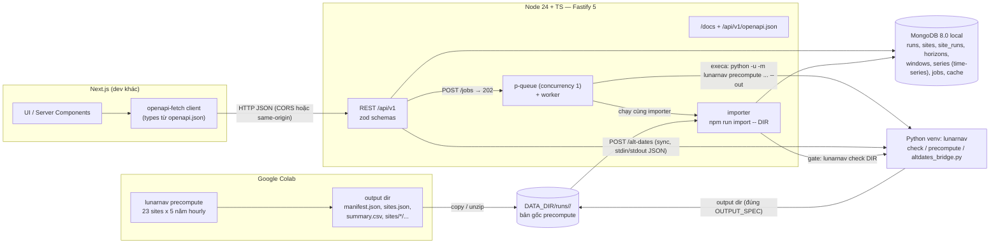

# Kế hoạch Web Backend — Lunar Landing Site Navigator (NASA Space Apps 2026)

> Trạng thái: **kế hoạch** (14-11-2026). Chưa cài gì, chưa tạo code. Mọi repo/package dưới đây đã được
> agent nghiên cứu nhìn thấy trong phiên này và được verifier giữ lại (hoặc hạ cấp — có ghi rõ).
> Số liệu stars/downloads là ảnh chụp ngày 13–14/11/2026.

---

## 1. Tóm tắt quyết định

### 1.1 Những gì bạn đã quyết (không bàn lại)
| Hạng mục | Quyết định |
|---|---|
| Backend | Node.js + TypeScript (máy dev: Node v24.16, npm 11) |
| Database | MongoDB cài **local** trên Windows 11 (không Docker) |
| Frontend | Next.js, do **người khác** làm → backend phải giao API contract rõ ràng, ổn định, có tài liệu |
| Dữ liệu | Import output precompute từ Colab vào MongoDB **và** gọi Python `lunarnav` on-demand cho toạ độ / khoảng ngày tuỳ chỉnh |
| Deploy | Sau này: SSH vào Linux VPS |
| Nguyên tắc | Hackathon 14–15/11/2026 → đơn giản, đã kiểm chứng, dễ học |

### 1.2 Stack được chọn (MỘT stack)
| Lớp | Chọn | Phiên bản (npm, 11/2026) |
|---|---|---|
| HTTP framework | **Fastify 5** | fastify 5.12.8 |
| Schema / validation / types | **zod 4** + `fastify-type-provider-zod` | zod 4.6.7, provider 7.0.0 |
| OpenAPI + docs | `@fastify/swagger` + `@fastify/swagger-ui` | 9.9.4 / 6.1.3 |
| DB access | **driver `mongodb` chính thức** (không Mongoose) | 7.9.0 |
| Hourly series | **MongoDB time-series collection** | MongoDB Server **8.0** |
| Python bridge | `execa` (spawn CLI, không shell) + `p-queue` + collection `jobs` tự viết | 10.2.1 / 10.0.0 |
| Import CSV | `csv-parse` (+ `csv-stringify` cho export) + `node:zlib` | 7.0.3 / 6.9.0 |
| Logging | pino (có sẵn trong Fastify) | — |
| Test | vitest + `app.inject()` của Fastify + mongodb-memory-server | 5.1.0 / 11.3.0 |
| Deploy | Ubuntu 24.04 + Node 24 (NodeSource) + **pm2** + **Caddy** (HTTPS tự động) + MongoDB 8.0 apt | pm2 7.1.2, Caddy 2.11.9 |
| Mock cho FE | Prism (`npx @stoplight/prism-cli@5.15.11 mock`) | 5.15.11 (xem §6.6) |

**Vì sao Fastify + zod:**
- Deliverable quan trọng nhất là **API contract cho FE**. Với Fastify, *một* zod schema của route = validate request + serialize/validate response + sinh OpenAPI (`openapi.json`). Không có bước "khai báo spec riêng" dễ lệch với code.
- Có sẵn chính chủ: pino logger, `app.inject()` để test không cần mở port, plugin cors/compress/rate-limit/helmet đều cập nhật 10–11/2026.
- Không bị kẹt vào starter cũ: starter Express tốt nhất (`edwinhern/express-typescript`) cần pnpm, build CJS, pin zod 3 + zod-to-openapi 7 → phải sửa nhiều thứ trước khi viết dòng code đầu tiên.
- zod dùng xuyên suốt: route schema, error schema, validate JSON mà Python in ra, `z.infer` cho generic `collection<T>()` → **một hệ schema duy nhất**.

**Runner-up: Express 5 + starter `edwinhern/express-typescript`** (zod + zod-to-openapi + swagger-ui-express). Chỉ đổi sang nếu cả đội đã thạo Express và không ai biết Fastify. Nếu chọn nhánh này: chạy `npm install` không lockfile (bỏ field `packageManager: pnpm`), đặt `"type":"module"`, **giữ nguyên cặp zod 3.25.76 + zod-to-openapi 7.3.4** (không trộn tài liệu zod 4). Mọi phần khác của kế hoạch (DB, Python, contract, deploy) giữ nguyên.

**Không dùng:** NestJS (học DI/decorator quá lâu cho 2 ngày), Hono (starter toàn SQL/edge), Mongoose (2 hệ schema + chậm khi import ~1M dòng), Redis/BullMQ (không có Redis), Docker (máy dev không có), RPC/GraphQL (FE cần spec trung lập ngôn ngữ + mock server).

---

## 2. Kiến trúc

### 2.1 Sơ đồ


Nguyên tắc:
1. **Một nguồn sự thật vật lý = `lunarnav`.** Node không tự cài lại luật visibility; chỉ cắt (clip), đếm, tra cứu giá trị đã lưu — và có parity test so với output Python (§9).
2. **Import, không tính lại.** Output Colab vào Mongo một lần; output job tuỳ chỉnh dùng **chính importer đó**.
3. **Giữ thư mục precompute gốc trên đĩa** (`DATA_DIR/runs/<run_id>/`, ~90 MB/run): Python bridge (alt-dates) đọc file, và cho phép tải raw file.
4. Mọi response có provenance: `run_id`, `params_fingerprint`, `step_s`, `precision_h` (= step_s/3600; ranh giới chính xác ± 1 bước).
5. Tên field **snake_case giống hệt OUTPUT_SPEC** (`sun_el_deg`, `pct_sun`, `longest_dark_h`…); thời gian ISO-8601 UTC có `Z`; thiếu = `null` (không NaN); kinh độ east [0, 360).

### 2.2 Vị trí code: **thư mục `backend\` trong repo hiện tại** (khuyến nghị)
Lý do: bridge Python import `lunarnav` cùng phiên bản; parity test dùng fixture sinh bởi `lunarnav`; contract + code + spec dữ liệu (`docs/OUTPUT_SPEC.md`) cùng version git. Repo `D:\UAV\lunar-navigator` là git nhưng **chưa có commit** → nên commit Python trước, rồi mới thêm `backend/`. FE ở repo riêng, chỉ cần file `backend/contract/openapi.json` (copy hoặc fetch `/api/v1/openapi.json`).

```
D:\UAV\lunar-navigator\
  lunarnav\  tests\  docs\  ...           (Python — KHÔNG sửa trong việc làm backend)
  .venv\Scripts\python.exe                (venv đã có — dùng làm PYTHON_BIN trên Windows)
  backend\
    package.json            "type": "module"
    tsconfig.json           module nodenext, strict
    .env.example            (commit)  .env (KHÔNG commit)
    ecosystem.config.cjs    pm2 trên VPS
    contract\openapi.json   ← FE dùng file này (commit, diff được)
    src\
      server.ts  app.ts  env.ts            (env validate bằng zod)
      schemas\   common.ts problem.ts site.ts run.ts series.ts windows.ts metrics.ts job.ts altDates.ts
      routes\    health meta runs sites horizon series windows instant compare ranking altDates jobs export
      domain\    windowsMath.ts metrics.ts rank.ts downsample.ts projection.ts ids.ts   (thuần, unit test)
      db\        client.ts collections.ts indexes.ts
      import\    importRun.ts              (CLI: npm run import -- <dir>)
      python\    runPython.ts  altdates_bridge.py
      jobs\      queue.ts worker.ts recovery.ts
    scripts\     export-openapi.ts
    test\        fixtures\run_small\  *.test.ts
```

Scripts `package.json` (dự kiến):
| Script | Lệnh |
|---|---|
| `dev` | `node --watch src/server.ts` (Node 24 type stripping; tsconfig `rewriteRelativeImportExtensions`, `erasableSyntaxOnly`, import có đuôi `.ts`) |
| `build` | `tsc -p tsconfig.build.json` → `dist/` |
| `start` | `node dist/server.js` |
| `import` | `node --env-file-if-exists=.env scripts/import-run.ts` |
| `openapi:export` | `node scripts/export-openapi.ts` → `contract/openapi.json` |
| `test` | `vitest run` |
| `mock` | `npx @stoplight/prism-cli@5.15.11 mock contract/openapi.json` |

**Ghim TypeScript 5.9.x** (npm `latest` đã là 7.0.2; openapi-typescript 7.13 peer `^5`; tránh ERESOLVE).

---

## 3. Repo / package GitHub đề xuất

Cách dùng: **npm i** = cài vào `backend/` sau này · **npx** = chạy không cài · **tham khảo** = chỉ đọc · **ops** = cài trên máy/VPS.
"↓" = verifier hạ cấp (dùng tuỳ chọn / có điều kiện).

### 3.1 Backend (dùng)
| Tên | Link | Dùng để | Cách dùng | Kiểm chứng (stars · downloads/tuần · hoạt động · license) |
|---|---|---|---|---|
| fastify | https://github.com/fastify/fastify | HTTP server, schema-native | npm i | 37,416★ · 22.4M · 5.12.8 (02/11/2026), commit 13/11 · MIT |
| @fastify/swagger | https://github.com/fastify/fastify-swagger | Sinh OpenAPI 3.x từ route schema; `app.swagger()` để export | npm i | 1,102★ · 4.56M · 9.9.4 (13/11/2026) · MIT |
| @fastify/swagger-ui | https://github.com/fastify/fastify-swagger-ui | Trang `/docs` | npm i | 192★ · 2.30M · 6.1.3 (03/11/2026) · MIT |
| zod | https://github.com/colinhacks/zod | Schema duy nhất (API, env, stdout Python, types) | npm i | 453M · 4.6.7 (12/10/2026) · MIT |
| fastify-type-provider-zod | https://github.com/turkerdev/fastify-type-provider-zod | Nối zod ↔ Fastify; `jsonSchemaTransform` cho swagger. Peer: zod ≥4.1.5, fastify ^5.5, @fastify/swagger ≥9.5.1, **cần thêm `openapi-types`** | npm i | 592★ · 2.09M · 7.0.0 (24/06/2026), commit 08/11 · MIT |
| @fastify/cors | https://github.com/fastify/fastify-cors | CORS allow-list từ env | npm i | 10.7M · 11.4.3 (13/11/2026) · MIT |
| @fastify/compress | https://github.com/fastify/fastify-compress | gzip/brotli cho JSON series (nén ở Fastify **hoặc** Caddy, không cả hai) | npm i | 230★ · 1.85M · 9.3.0 (27/10/2026) · MIT |
| @fastify/rate-limit | https://github.com/fastify/fastify-rate-limit | Giới hạn theo IP/route (in-memory) | npm i | 5.05M · 11.2.2 (02/11/2026) · MIT |
| @fastify/helmet | https://github.com/fastify/fastify-helmet | Security headers | npm i | 3.9M · 13.2.0 (13/10/2026) · MIT |
| mongodb (driver) | https://github.com/mongodb/node-mongodb-native | Truy cập Mongo, `insertMany(ordered:false)`, time-series, aggregation | npm i | 10,172★ · 21.3M · 7.9.0 (12–13/11/2026) · Apache-2.0 · engines node ≥20.19 |
| execa | https://github.com/sindresorhus/execa | Spawn Python: timeout, `cancelSignal`, `forceKillAfterDelay`, đọc từng dòng | npm i | 7,641★ · 229M · 10.2.1 (23/10/2026) · MIT · **ESM-only**, node ≥22 |
| p-queue | https://github.com/sindresorhus/p-queue | Giới hạn số job Python chạy đồng thời | npm i | 4,305★ · 54M · 10.0.0 (12/10/2026) · MIT · ESM-only |
| csv-parse / csv-stringify (node-csv) | https://github.com/adaltas/node-csv | Stream đọc `*.csv(.gz)` khi import; ghi CSV export (cùng monorepo, không cần fast-csv) | npm i | 4,289★ · csv-parse 27.6M (7.0.3), csv-stringify 12.6M (6.9.0) · MIT |
| pino | https://github.com/pinojs/pino | Logger (đã tích hợp sẵn trong Fastify — không cần pino-http) | (đi kèm fastify) | 18,296★ · 76M · 10.4.0 · MIT |
| vitest + mongodb-memory-server | https://github.com/typegoose/mongodb-memory-server | Test với mongod thật dùng một lần; trỏ `MONGOMS_SYSTEM_BINARY` vào mongod.exe local để khỏi tải binary | npm i -D | mms 2,857★ · 3.0M · 11.3.0 (20/10/2026); vitest 5.1.0 · 180M · MIT |
| ↓ @scalar/fastify-api-reference | https://github.com/scalar/scalar | Trang docs đẹp hơn Swagger UI (tuỳ chọn — chọn **một** UI) | npm i (tuỳ) | 16,402★ · 559k · 1.78.1 · MIT |
| ↓ @fastify/etag, @fastify/sensible, @fastify/under-pressure | https://github.com/fastify/fastify-etag · https://github.com/fastify/fastify-helmet | ETag tự động / httpErrors / 503 khi quá tải — tuỳ chọn. ETag tự đặt từ `params_fingerprint` rẻ hơn | npm i (tuỳ) | 127k / 1.2M / 355k · MIT |
| ↓ better-sse | https://github.com/MatthewWid/better-sse | SSE tiến độ job (phase 2; polling vẫn là contract chính) | npm i (tuỳ) | 834★ · 121k · 0.16.1 (pre-1.0) · MIT |
| ↓ stream-json | https://github.com/uhop/stream-json | Chỉ khi `windows.json` lớn hàng chục MB | npm i (nếu cần) | 1,207★ · 15M · 3.9.0 · BSD-3 |

### 3.2 Contract / phía FE (đưa cho dev Next.js)
| Tên | Link | Dùng để | Cách dùng | Kiểm chứng |
|---|---|---|---|---|
| openapi-typescript + openapi-fetch (+ openapi-react-query) | https://github.com/openapi-ts/openapi-typescript | Sinh TS types từ `openapi.json`; client fetch có type, chạy cả Server/Client Components | FE: npm i -D / npx | 8,437★ · ~16.8M mỗi gói · 7.13.0/0.17.0 (11/02/2026) · MIT · **peer typescript ^5** |
| Prism (@stoplight/prism-cli) | https://github.com/stoplightio/prism | Mock server từ OpenAPI (port 4010); `prism proxy` để kiểm response thật khớp spec | npx | 5,070★ · 326k · Apache-2.0 · **5.16.0 cần Node ≥24.18 → dùng 5.15.11** (≥24.14) hoặc nâng Node |
| ↓ @scalar/mock-server | https://github.com/scalar/scalar | Mock thay thế nếu Prism lỗi (node ≥22.19) | npx | 74k · 0.21.2 · MIT |
| orval | https://github.com/orval-labs/orval | (FE tự chọn) sinh hooks React Query/SWR + MSW mocks | FE | 6,613★ · 3.7M · 8.47.0 · MIT |
| @hey-api/openapi-ts | https://github.com/hey-api/hey-api | (FE tự chọn) SDK generator; peer TS ≥5.5.3 (nhận TS 6) — pin version (0.x) | FE | 5,577★ · 7.4M · 0.99.0 · MIT |
| msw + openapi-msw (tuỳ chọn) | https://github.com/mswjs/msw | Mock trong test component phía FE | FE | msw 18,350★ · 33M; openapi-msw 91★ · MIT |
| @redocly/cli | https://github.com/Redocly/redocly-cli | `npx @redocly/cli lint contract/openapi.json` | npx | 1,559★ · 4.2M · 2.78.0 · MIT |
| oasdiff (sau hackathon) | https://github.com/oasdiff/oasdiff | Phát hiện breaking change giữa 2 bản spec. **Binary Go — KHÔNG `npm install oasdiff`** (gói npm là placeholder bảo mật) | binary release | 1,464★ · v1.37.0 (09/11/2026) · Apache-2.0 |

### 3.3 Ops / deploy
| Tên | Link | Dùng để | Cách dùng | Kiểm chứng |
|---|---|---|---|---|
| MongoDB Server/Shell/DatabaseTools (winget) | https://github.com/microsoft/winget-pkgs/tree/master/manifests/m/MongoDB | Cài MongoDB local trên Windows | ops (winget) | Server 8.0.23 … 9.0.4; Shell 2.9.2; DatabaseTools 100.20.1 · SSPL (server), Apache-2.0 (tools) |
| MongoDB on Ubuntu + security checklist | https://www.mongodb.com/docs/manual/tutorial/install-mongodb-on-ubuntu/ | Cài + harden trên VPS | ops | trang docs chính thức (HTTP 200) |
| mongodump / mongorestore | https://www.mongodb.com/docs/database-tools/mongodump/ | Backup + chuyển DB Windows → VPS | ops | mongo-tools 100.20.1 (02/11/2026) · Apache-2.0 |
| pm2 | https://github.com/Unitech/pm2 | Process manager, `pm2 startup systemd` | ops (global trên VPS) | 43,334★ · 3.9M · 7.1.2 (03/11/2026) · AGPL-3.0 (không ảnh hưởng code app vì chỉ chạy nó) |
| Caddy | https://github.com/caddyserver/caddy | Reverse proxy + HTTPS tự động | ops (apt) | 79,021★ · v2.11.9 (05/11/2026) · Apache-2.0 |
| nodesource/distributions | https://github.com/nodesource/distributions | Node 24 system-wide trên Ubuntu (tránh lỗi PATH của nvm khi SSH/pm2) | ops | 13,857★ · commit 30/10/2026 · MIT |
| uv (tuỳ chọn) | https://docs.astral.sh/uv/ | Tạo venv Python nhanh; `python3 -m venv` cũng đủ | ops | 91,970★ · 0.13.8 · MIT/Apache-2.0 |
| systemd (thay pm2 — chỉ chọn một) | https://www.freedesktop.org/software/systemd/man/latest/systemd.service.html | Unit file nếu đội quen Linux | ops | LGPL-2.1 |
| ↓ Nginx + certbot (thay Caddy — chỉ chọn một) | https://nginx.org/ | Nếu VPS đã có Nginx | ops | BSD-2 |
| appleboy/ssh-action (phase 2) | https://github.com/appleboy/ssh-action | GitHub Actions SSH deploy; pin `@v1.2.5` hoặc SHA | CI | 6,239★ · MIT |
| ↓ Burnett01/rsync-deployments | https://github.com/Burnett01/rsync-deployments | rsync artifact từ CI (Git Bash không có rsync) | CI (tuỳ) | 448★ · MIT |

### 3.4 Phase 2 / dự phòng (không làm trong hackathon trừ khi cần)
| Tên | Link | Khi nào | Kiểm chứng |
|---|---|---|---|
| ↓ agenda v6 + @agendajs/mongo-backend | https://github.com/agenda/agenda | Cần job bền qua restart, retry, scheduling. ESM-only; dùng polling mặc định (change streams cần replica set) | 9,712★ · 208k · 6.2.8 (13/11/2026) · MIT |
| FastAPI + uvicorn (sidecar Python) | https://github.com/fastapi/fastapi | Khi cold start Python > ~30% thời gian job, muốn cache SPICE/LOLA "nóng". Giữ nguyên JSON contract → đổi 1 file bên Node | 104,682★ · fastapi 0.162.7 · MIT / BSD-3 |
| ↓ astronomy-engine | https://github.com/cosinekitty/astronomy | Cross-check vài mẫu Sun/Earth hoặc preview "ngay bây giờ" — **không** dùng cho kết quả chấm điểm | 1,111★ · 467k · npm 2.1.19 (12/2023) · MIT |
| mongoose (chỉ nếu có người đã thạo) | https://github.com/Automattic/mongoose | Chỉ cho collection nhỏ; không dùng cùng driver làm lớp chính, không dùng để import series | 27,446★ · 9.0M · 9.12.1 · MIT |

### 3.5 Chỉ tham khảo (KHÔNG clone làm khung)
| Tên | Link | Lấy gì | Kiểm chứng |
|---|---|---|---|
| ↓ fastify/demo | https://github.com/fastify/demo | Pattern close-with-grace, @fastify/env, autoload. Bỏ knex/MySQL/docker-compose | 240★ · commit 22/10/2026 · MIT |
| ↓ edwinhern/express-typescript | https://github.com/edwinhern/express-typescript | Runner-up (nếu chọn Express); cách tổ chức zod→OpenAPI | 1,246★ · commit 25/03/2026 · MIT · cần xử lý pnpm/CJS |
| express 5 | https://github.com/expressjs/express | Runner-up framework | 69,679★ · 194M · 5.3.0 · MIT |
| EmanuelAbasto/CLPS-Lunar-Mission-Browser | https://github.com/EmanuelAbasto/CLPS-Lunar-Mission-Browser | Ý tưởng API: id `custom:{lat}:{lon}`, `/health` báo version thư viện, toggle terrain/flat, client TS sinh từ OpenAPI. **Đội thi cùng challenge → không copy code** | 2★ · commit 19/09/2026 · MIT |
| ↓ kvsankar/moon-mission | https://github.com/kvsankar/moon-mission | Ý tưởng trang "data status" → `GET /runs` | 11★ · MIT |
| ↓ Iris Data Labs API (dịch vụ đóng) | https://dev.to/irisdatalabs/our-lunar-landing-site-api-goes-live-today-1hig | Prefix `/api/v1`, mảng `reasons[]` cạnh mỗi kết quả xếp hạng, export CSV + GeoJSON | bài viết, proprietary |
| ↓ hesreallyhim/awesome-claude-code | https://github.com/hesreallyhim/awesome-claude-code | Danh sách tham khảo; không cần cài gì từ đây | 57,933★ · NOASSERTION |

Đã cân nhắc và **không dùng** (verifier giữ với verdict "avoid"): NestJS / brocoders/nestjs-boilerplate, Hono / w3cj/hono-open-api-starter, muneebhashone/typescript-backend-toolkit (cần Redis), bullmq (cần Redis), Typegoose/Papr/Prisma, pythonia, zeromq/gRPC, openapi-backend, apache-arrow (hoãn).

---

## 4. Claude Code plugins / skills / MCP

> Tất cả là **việc bạn tự làm sau**, không làm trong bước này.

| Ưu tiên | Tên (đúng như trong directory) | Nguồn / độ tin | Cài thế nào | Ghi chú |
|---|---|---|---|---|
| 1 — nên cài | **MongoDB (Self-Managed MCP)** (plugin `mongodb`) | Partner chính chủ MongoDB; https://github.com/mongodb/agent-skills (198★, Apache-2.0, v1.2.1 10/11/2026). Gồm `mongodb-mcp-server` + skills `mongodb-schema-design`, `mongodb-query-optimizer`, `mongodb-connection`, `mongodb-mcp-setup`… | `/plugin install mongodb` rồi `/reload-plugins` | `mcp.json` của plugin chạy `npx -y mongodb-mcp-server@<4` **không có `--readOnly`, không connection string**. Đặt biến môi trường user Windows: `MDB_MCP_CONNECTION_STRING=mongodb://127.0.0.1:27017/lunarnav`, `MDB_MCP_READ_ONLY=true`, `MDB_MCP_TELEMETRY=disabled`. Chỉ trỏ vào DB **dev local**. Nếu MCP không khởi động trên Windows, thử bọc `cmd /c npx ...` (chưa xác minh) |
| 2 — nên cài | **typescript-lsp** | Plugin chính chủ Anthropic (https://github.com/anthropics/claude-plugins-official/tree/main/plugins/typescript-lsp) | `/plugin install typescript-lsp` | **Yêu cầu cài global:** `npm install -g typescript-language-server typescript` (bạn tự duyệt) |
| 3 — tuỳ chọn | **context7** | External plugin trong claude-plugins-official (https://github.com/anthropics/claude-plugins-official/tree/main/external_plugins/context7); MCP hosted `https://mcp.context7.com/mcp` | `/plugin install context7` | Giúp lấy docs mới (Fastify 5, driver 7, zod 4). Chỉ gửi **tên thư viện** ra dịch vụ bên thứ ba |
| 4 — tuỳ chọn | **security-guidance** | Plugin chính chủ (https://github.com/anthropics/claude-plugins-official/tree/main/plugins) | `/plugin install security-guidance` | Nên bật trước khi deploy: backend spawn Python với input người dùng (injection / DoS) |
| 5 — tuỳ chọn, đọc trước | ↓ **Fastify Backend Skills** (tác giả Dankosik) | Community, Anthropic Directory, **không có upstream repo để audit** | qua directory | 15 skills (fastify-routes, fastify-testing, fastify-security…). Khớp stack Fastify; đọc từng SKILL.md trước khi tin |
| Thay thế cho #1 | mongodb/agent-skills (chỉ skills, không MCP) | https://github.com/mongodb/agent-skills | copy `skills/mongodb-schema-design`, `skills/mongodb-query-optimizer` vào `backend/.claude/skills/` | Chọn **một**: plugin hoặc skills-only |
| Không khuyến nghị | ↓ **ultrapowers-dev** | Community, ~55 skills, không upstream repo | — | Có `express-patterns`, `nestjs-patterns` nhưng không có Fastify → dễ kéo code lệch stack |
| Không cần | ↓ mcp-openapi-schema-explorer (kadykov) | https://github.com/kadykov/mcp-openapi-schema-explorer (76★) | — | Claude đọc thẳng `contract/openapi.json` được |
| Có sẵn | `/code-review`, `skill-creator` | đã có trong phiên | — | Có thể tạo skill riêng `lunarnav-api-contract` từ §6 |

**KHÔNG làm:**
- Không cài plugin **MongoDB Atlas (Managed MCP)** — chỉ thấy Atlas, không thấy mongod local/VPS. Không cài cả 2 plugin MongoDB.
- Không chạy thêm `claude mcp add mongodb ...` khi đã cài plugin → trùng 2 MCP server.
- Không trỏ MongoDB MCP vào DB production trên VPS.
- Không cài plugin "API Doc Generator" (sinh docs bằng LLM; ta sinh OpenAPI từ route schema).
- Thay cho skill pack chung chung: viết `backend/CLAUDE.md` ngắn ghi luật contract (`/api/v1`, OpenAPI từ zod, problem+json, UTC ISO-8601, snake_case = OUTPUT_SPEC, không shell khi spawn).

---

## 5. MongoDB

### 5.1 Phiên bản: **MongoDB Community 8.0** (Windows + VPS cùng major)
- Time-series cần ≥5.0; ≥6.3 tự tạo index `{meta, time}` cho time-series. 8.0 thoả mãn, có trên winget (8.0.23) và apt Ubuntu 24.04.
- Không chọn 9.0 ngay vì **chưa xác minh** driver 7.9 hỗ trợ server 9.0 (kiểm tra bảng compatibility của driver trước khi lên 9.0).

### 5.2 Cài trên Windows 11 (bạn tự chạy khi sẵn sàng)
```powershell
winget install -e --id MongoDB.Server --version 8.0.23
winget install -e --id MongoDB.Shell            # mongosh (MSI server KHÔNG kèm mongosh)
winget install -e --id MongoDB.DatabaseTools    # mongodump/mongorestore/mongoimport (100.20.1)
winget install -e --id MongoDB.Compass.Community   # tuỳ chọn, GUI
Get-Service MongoDB                              # phải "Running"
mongosh --eval "db.runCommand({ ping: 1 })"
```
- Hướng dẫn chính thức: https://www.mongodb.com/docs/manual/tutorial/install-mongodb-on-windows/ . Nếu winget không tạo service, chạy MSI từ trang tải chính thức và chọn "Install MongoD as a Service".
- Mặc định bind `127.0.0.1`, không auth → ổn cho dev. Thêm `C:\Program Files\MongoDB\Server\8.0\bin` vào PATH nếu cần.
- Standalone là đủ (không cần replica set: không dùng change streams; tiến độ job dùng polling).

### 5.3 Collections (database `lunarnav`)
Một **run** = một thư mục precompute (một provider + DEM + horizon method). Dữ liệu 23 site × 43,824 giờ (2026-01-01 → 2031-01-01, bước 3600 s).

| Collection | 1 doc = | Field chính | Index | Ước lượng |
|---|---|---|---|---|
| `runs` | 1 run (manifest.json) | `_id`=run_id, `kind` (`precompute`/`custom`), `is_default`, `label`, `manifest` (nguyên văn), `manifest_sha256`, `params_fingerprint`, `source_dir`, `status` (`importing`/`ready`/`failed`), `imported_at`, `expires_at` (custom) | `{is_default:1}`, `{kind:1, imported_at:-1}` | 1 doc ~20 KB |
| `sites` | 1 site (catalog + custom) | `_id`=site_id (`a3_peak_near_cabeus_b`, `custom:-89.4500:222.6900`), name, group, origin, lat_deg, lon_deg, source, note, `extra` (accuracy, region_corners_latlon…), `map {x_km,y_km}` (polar stereographic, tính lúc import) | `{group:1}`, `{origin:1}` | 23 doc ~100 KB |
| `site_runs` | (run, site) | `run_id`, `site_id`, `record` (sites.json), `metrics` (windows.json), `rank`, `score` + các cột summary.csv, `range_start_utc`, `range_end_utc`, `n_samples`, `step_s` | unique `{run_id:1, site_id:1}`, `{run_id:1, rank:1}` | 23 doc/run ~60 KB |
| `horizons` | (run, site) | `method`, `az_step_deg`, `az_deg[]`, `el_deg[]`, `covered_radius_km[]` | unique `{run_id:1, site_id:1}` | ~30 KB/doc → ~0.7 MB/run |
| `windows` | 1 window | `run_id, site_id, kind` (`sun`/`earth`/`both`), `state`, `start`, `end` (Date, exclusive), `duration_h`, `start_index`, `end_index`, `truncated_start`, `truncated_end` | `{run_id:1, site_id:1, kind:1, start:1}` | ~20–50k doc, ~5–12 MB/run (ước lượng) |
| **`series`** (time-series) | 1 mẫu giờ | `t` (Date), `meta {run_id, site_id}`, các cột visibility.csv.gz giữ **nguyên tên** (sun_az_deg, sun_el_deg, earth_*, *_semidiam_deg, horizon_el_*, *_clearance_deg, sun_fraction, earth_fraction, power_horizontal, power_tracking, irradiance_tracking_wm2, *_dist_km, sun/earth/both_visible (bool), hours_until_* (null nếu rỗng)) | tự động `{meta, t}` (≥6.3); thêm `{"meta.run_id":1, "meta.site_id":1, t:1}` nếu explain cho thấy cần | 1,007,952 doc/run. BSON thô ~600 MB; trên đĩa sau nén cột **ước ~100–300 MB/run — chưa đo, đo bằng `db.series.stats()` sau import** |
| `jobs` | 1 job tuỳ chỉnh | `_id`, `type` (`custom_site`), `status` (`queued`/`running`/`succeeded`/`failed`/`cancelled`), `params`, `params_hash`, `progress {stage, pct?, lines[]}`, `stderr_tail`, `result {run_id, site_id}`, `error {code,message}`, `created_at`, `started_at`, `finished_at`, `expires_at` | `{params_hash:1, status:1}`, `{status:1, created_at:1}`, TTL `{expires_at:1}` (30 ngày) | vài KB/doc |
| `cache` | response đắt (alt-dates) | `_id`=sha256(endpoint+params+params_fingerprint), `body`, `expires_at` | TTL `{expires_at:1}` | nhỏ |

**Không import `ephemeris_*.csv.gz`** vào Mongo: az/el/dist đã có trong visibility (spec §3.4 đảm bảo trùng ±3e-6°). File vẫn nằm trên đĩa để tải về / provenance.

### 5.4 Quyết định time-series
| Phương án | Ưu | Nhược | Chọn? |
|---|---|---|---|
| (a) 1 doc thường / giờ | Đơn giản nhất | ~1.4 GB BSON, chậm nhất | Không |
| **(b) Time-series collection** (`timeField:"t"`, `metaField:"meta"`, `granularity:"hours"`) | Vẫn ghi/đọc doc từng giờ (code đơn giản như (a)); MongoDB tự bucket + nén cột; meta cardinality thấp (23–46 series) đúng khuyến nghị docs; downsample bằng `$dateTrunc` | timeField/metaField cố định khi tạo; update/delete hạn chế (xoá theo `meta` vẫn được) — vô hại với dữ liệu import-một-lần | **CHỌN** |
| (c) Bucket thủ công 720 mẫu/doc (mảng cột) | Ít doc (~1.4k/run), slice theo index dễ | Tự viết pack/unpack/cắt khoảng; time-series đã làm việc này bên trong | Runner-up |
| (d) GridFS | — | File <16 MiB, không cần | Không — raw file phục vụ static từ đĩa |

Tạo collection (trong `src/db/indexes.ts`, chạy lúc khởi động, idempotent):
```ts
await db.createCollection("series", { timeseries: { timeField: "t", metaField: "meta", granularity: "hours" } });
```
TTL **không** đặt trên `series` (TTL của time-series áp cho toàn collection); run custom hết hạn được dọn bằng một interval trong Node: `deleteMany({"meta.run_id": id})` + xoá ở các collection khác + xoá thư mục.

---

## 6. API contract (cho dev Next.js)

### 6.1 Quy ước chung
- Base: `/api/v1`. Spec: `GET /api/v1/openapi.json`. Docs: `/docs`. File commit: `backend/contract/openapi.json`.
- JSON, snake_case = OUTPUT_SPEC. Thời gian ISO-8601 UTC có `Z`. `end` luôn **exclusive**. Server "snap" `start`/`end` xuống ranh giới mẫu và echo lại giá trị thật đã dùng.
- `run_id` là query tuỳ chọn ở mọi GET dữ liệu; mặc định = run có `is_default:true`.
- `site_id` có thể chứa `:` (`custom:-89.4500:222.6900`) → FE luôn `encodeURIComponent` khi đặt vào path.
- Mọi response dữ liệu có `run_id`, `step_s`, `precision_h`.
- **Luật thay đổi v1: chỉ thêm** (field/endpoint optional mới). Breaking → `/api/v2`.

### 6.2 Endpoints (P0 = có stub + mock ngày 1; P1 = dữ liệu thật ngày 1; P2 = ngày 2)
| # | Method + path | Mục đích (UI) | Nguồn | Ưu tiên |
|---|---|---|---|---|
| 1 | `GET /health` | api_version, lunarnav code_version, mongo ok, python ok, default_run_id | TS | P0 |
| 2 | `GET /meta` | Enum + giới hạn cho UI: danh sách field series kèm đơn vị, objectives alt-dates, rank weights mặc định, max_points, giới hạn job | static TS | P0 |
| 3 | `GET /runs`, `GET /runs/{run_id}` | Chọn run, "about the data" (manifest, data_sources, conventions) | Mongo | P1 |
| 4 | `GET /sites?group=&run_id=&format=json\|geojson` | Danh mục + marker bản đồ (+ polygon vùng Artemis trong GeoJSON) | Mongo | P0 |
| 5 | `GET /sites/{site_id}?run_id=` | Thẻ site: record, extra, metrics toàn khoảng, rank/score | Mongo | P0 |
| 6 | `GET /sites/{site_id}/horizon?run_id=` | Silhouette đường chân trời (sky diagram) | Mongo | P0 |
| 7 | `GET /sites/{site_id}/series?start=&end=&fields=&max_points=2000&agg=sample\|minmax` | Đường cong timeline, vệt Sun/Earth trên sky diagram | Mongo (`$dateTrunc`) | P0 |
| 8 | `GET /sites/{site_id}/windows?start=&end=&kinds=sun,earth,both` | Dải timeline (FE vẽ từ windows, **không** từ series thô) | Mongo + clip TS | P0 |
| 9 | `GET /sites/{site_id}/instant?t=` | Readout tại vị trí thanh trượt: az/el, horizon, clearance, fraction, power, cờ, giờ tới sunset/sunrise/earthset/earthrise | Mongo (mẫu ≤ t) | P1 |
| 10 | `POST /compare` | So sánh 2–4 site trong một khoảng ngày: metrics, ranking, windows, series tuỳ chọn | Mongo + TS | P1 |
| 11 | `GET /ranking?group=&start=&end=&weights=pct_sun:0.4,pct_earth:0.3,pct_both:0.3` | Bảng xếp hạng tất cả site | full range + weight mặc định → summary; khác → TS | P1 |
| 12 | `POST /alt-dates` | "Lịch trượt": ngày hạ cánh thay thế | **Python bridge, sync ≤30 s, cache** | P2 |
| 13 | `POST /jobs` → `202`; `GET /jobs/{job_id}`; `DELETE /jobs/{job_id}` | Toạ độ tuỳ chỉnh và/hoặc khoảng ngày ngoài run | **Python async** | P2 |
| 14 | `GET /jobs/{job_id}/events` (SSE) | Tiến độ realtime — tuỳ chọn, polling vẫn là contract | TS | P2+ |
| 15 | `GET /sites/{site_id}/export/series.csv`, `/export/windows.csv`, `GET /export/summary.csv`, `GET /runs/{run_id}/files/{path}` (raw, `ETag`=sha256) | Tải dữ liệu | stream TS / static | P2 |

### 6.3 Ví dụ request/response
**`GET /api/v1/sites?group=south_pole`**
```json
{"run_id":"pf_3f9a1c0d2b7e4a11","step_s":3600,"precision_h":1,
 "sites":[{"id":"a3_peak_near_cabeus_b","name":"Artemis III region: Peak near Cabeus B","group":"south_pole",
   "origin":"catalog","lat_deg":-83.6195,"lon_deg":291.3677,
   "map":{"projection":"south_polar_stereographic_R1737.4km","x_km":-163.2,"y_km":64.0},
   "dem_source":"trek:LRO_LOLA_DEM_SPole875_5mp_v04_EQ",
   "rank":7,"score":61.2,"pct_sun":72.4,"pct_earth":55.1,"pct_both":41.0,"longest_dark_h":412.0}]}
```
(Số liệu minh hoạ; mock lấy từ `examples` trong schema.)

**`GET /api/v1/sites/{id}/horizon`**
```json
{"run_id":"…","site_id":"…","method":"raymarch","dem_source":"…","az_step_deg":0.5,
 "az_deg":[0,0.5,1.0],"el_deg":[1.23,1.19,1.15],"covered_radius_km":[150,150,150],
 "min_el_deg":-0.4,"max_el_deg":2.9}
```
Horizon tại azimuth bất kỳ = nội suy tuyến tính tuần hoàn (như `HorizonMask.at`).

**`GET /api/v1/sites/{id}/series?start=2027-03-01T00:00:00Z&end=2027-04-01T00:00:00Z&fields=sun_el_deg,earth_el_deg,sun_visible&max_points=2000`** — dạng cột, thời gian ngầm định
```json
{"run_id":"…","site_id":"…","start":"2027-03-01T00:00:00Z","end":"2027-04-01T00:00:00Z",
 "step_s":3600,"bin_s":3600,"n":744,"agg":"sample","precision_h":1,
 "fields":{"sun_el_deg":[0.84,0.91],"earth_el_deg":[3.1,3.0],"sun_visible":[true,true]}}
```
- Điểm i ở `start + i*bin_s`. Nếu số mẫu > `max_points`, server tự chọn `bin_s` (bội của step_s).
- `agg=sample`: giá trị đầu mỗi bin. `agg=minmax`: mỗi field thành `{"min":[…],"max":[…]}`, cờ bool thành tỉ lệ true (0..1).
- Giới hạn: ≤ 8 fields, `max_points` ≤ 5000; vượt → `400` problem với gợi ý.

**`GET /api/v1/sites/{id}/windows?start=…&end=…&kinds=sun,earth`**
```json
{"run_id":"…","site_id":"…","precision_h":1,
 "sun":[{"start":"2027-03-01T00:00:00Z","end":"2027-03-18T12:00:00Z","duration_h":420.0,"state":true,
         "truncated_start":false,"truncated_end":false,"clipped_start":true,"clipped_end":false}],
 "earth":[]}
```
Truy vấn: `start < end_q AND end > start_q`; clip vào khoảng truy vấn → `clipped_*` (khác `truncated_*` = chạm biên run).

**`GET /api/v1/sites/{id}/instant?t=2027-03-14T05:30:00Z`**
```json
{"t":"2027-03-14T05:30:00Z","sample_utc":"2027-03-14T05:00:00Z","precision_h":1,
 "sun":{"az_deg":131.2,"el_deg":0.84,"horizon_el_deg":0.31,"clearance_deg":0.53,"fraction":1.0,"visible":true,
        "power_horizontal":0.0147,"irradiance_tracking_wm2":1366.2},
 "earth":{"az_deg":137.9,"el_deg":3.1,"horizon_el_deg":1.2,"clearance_deg":1.9,"visible":true},
 "hours_until":{"sunset":102.5,"sunrise":0,"earthset":36.0,"earthrise":0}}
```
Lấy mẫu k = floor((t − t0)/step) và đọc thẳng các cột `hours_until_*` (null = không có sự kiện trước cuối run).

**`POST /api/v1/compare`**
```json
{"run_id":"pf_…","site_ids":["a3_peak_near_cabeus_b","ref_connecting_ridge_c1","apollo11"],
 "start":"2027-01-01T00:00:00Z","end":"2028-01-01T00:00:00Z",
 "weights":{"pct_sun":0.4,"pct_earth":0.3,"pct_both":0.3},
 "include":{"windows":["sun","earth"],"series":{"fields":["sun_el_deg","earth_el_deg"],"max_points":1500}}}
```
→ `{"range":{"start","end","step_s":3600,"n_samples":8760},"ranking":[{"rank":1,"site_id":"…","score":…,"pct_sun":…,"pct_earth":…,"pct_both":…,"longest_dark_h":…,"longest_comms_gap_h":…}],"sites":{"<id>":{"metrics":{…đủ bộ metrics OUTPUT_SPEC §3.6…},"windows":{…},"series":{…},"warnings":["smooth-sphere horizon (dem_source none:outside-…)"]}}}`.
Khoảng = toàn run và weights mặc định → trả metrics nguyên văn từ `site_runs` (đúng giá trị Python).

**`POST /api/v1/alt-dates`** (map 1:1 với `DateConstraints` / CLI `alt-dates`)
```json
{"run_id":"pf_…","site_id":"ref_connecting_ridge_c1","earliest":"2027-03-01T00:00:00Z","latest":"2027-06-01T00:00:00Z",
 "mission_h":336,"max_results":10,
 "constraints":{"min_sun_pct":70,"min_earth_pct":0,"min_both_pct":0,"require_sun_at_landing":true,
   "require_earth_at_landing":true,"min_continuous_sun_h":0,"min_continuous_earth_h":0,
   "max_dark_gap_h":null,"max_comms_gap_h":null,"min_sun_el_at_landing_deg":null,
   "objective":"balanced","min_separation_h":12}}
```
→ đúng `AltDateResult.to_dict()` + `cache_id`: `{"site_id","earliest_utc","latest_utc","mission_duration_h","constraints","n_evaluated":2209,"n_feasible":143,"rejected_by":{"min_sun_pct":1800},"candidates":[{"rank":1,"landing_utc":"…Z","mission_end_utc":"…Z","slip_h":…,"score":…,"sun_pct":…,"earth_pct":…,"both_pct":…,"longest_dark_h":…,…}]}`.
`candidates` rỗng = **200** kèm `rejected_by` (không phải lỗi). `mission_h` phải là bội của step; `latest + mission_h` phải nằm trong run, nếu không → `422` kèm `max_latest`.

**`POST /api/v1/jobs`**
```json
{"type":"custom_site","lat_deg":-89.45,"lon_deg":222.69,"name":"My ridge",
 "start":"2027-01-01T00:00:00Z","end":"2028-01-01T00:00:00Z","step_min":60,
 "provider":"spice","dem":"pgda","horizon_method":"raymarch","observer_height_m":2}
```
(hoặc `"site_id":"<catalog id>"` thay lat/lon để tính khoảng ngày ngoài 2026–2030.)
→ `202 {"job_id":"j_…","status":"queued","site_id":"custom:-89.4500:222.6900","poll":"/api/v1/jobs/j_…"}`
→ cache hit (cùng `params_hash`, đã `succeeded`) → `200` với job cũ.
`GET /jobs/{id}` → `{"job_id","status":"running","progress":{"stage":"precompute","lines":["[1/1] custom:-89.4500:222.6900: …"]},"result":null,"error":null}` → khi xong `{"status":"succeeded","result":{"run_id":"job_j_…","site_id":"custom:-89.4500:222.6900"}}`.
Sau đó FE gọi **chính các endpoint 5–11 với `run_id=job_j_…`** → không cần nhánh code riêng.

### 6.4 Lỗi: RFC 9457 `application/problem+json`
```json
{"type":"https://lunarnav.example/errors/out-of-range","title":"Range outside run","status":422,
 "code":"OUT_OF_RANGE","detail":"end 2032-01-01T00:00:00Z > run end 2031-01-01T00:00:00Z",
 "instance":"/api/v1/sites/apollo11/series","errors":[{"path":"end","message":"must be ≤ 2031-01-01T00:00:00Z"}]}
```
| HTTP | `code` | Khi nào |
|---|---|---|
| 400 | `VALIDATION_ERROR` | zod/query sai (kèm `errors[]`) |
| 400 | `TOO_MANY_POINTS` | vượt max_points / fields |
| 401 | `UNAUTHORIZED` | thiếu / sai API key (`X-API-Key`), hoặc thiếu HTTP Basic của `/docs` (thêm 14/11) |
| 404 | `SITE_NOT_FOUND`, `RUN_NOT_FOUND`, `JOB_NOT_FOUND` | |
| 409 | `RUN_NOT_READY` | run đang import |
| 422 | `OUT_OF_RANGE`, `BAD_MISSION_LENGTH` | ngữ nghĩa sai |
| 429 | `RATE_LIMITED`, `QUEUE_FULL` | rate limit / hàng đợi job đầy |
| 500 | `INTERNAL` | |
| 502 | `PYTHON_FAILED` | Python exit ≠ 0 (job dùng `status:failed` + `error`) |
| 504 | `PYTHON_TIMEOUT` | alt-dates quá 30 s |

Một `app.setErrorHandler` (~30 dòng) + một zod `Problem` schema được tham chiếu ở mọi response 4xx/5xx → xuất hiện trong spec và types của FE.

### 6.5 Quy trình OpenAPI (schema-first trong code)
1. Viết zod schemas ở `src/schemas/` (có ví dụ cho từng schema — dùng metadata của zod 4; kiểm tra cách `fastify-type-provider-zod` đưa examples vào spec khi code).
2. Đăng ký `validatorCompiler`, `serializerCompiler`, `@fastify/swagger` với `transform: jsonSchemaTransform`, `openapi: "3.1.0"` (nếu 3.1 gặp vấn đề với tool FE thì để 3.0.3).
3. Route stub trả dữ liệu thật trích từ 1–2 site (fixture) → mock và stub đều thực tế.
4. `npm run openapi:export` (boot app, `await app.ready()`, ghi `app.swagger()` ra `contract/openapi.json`) → commit; mọi thay đổi contract hiện ra trong git diff.
5. `npx @redocly/cli lint contract/openapi.json`.

### 6.6 Mock server cho dev FE
```bash
npx @stoplight/prism-cli@5.15.11 mock backend/contract/openapi.json   # http://127.0.0.1:4010
npx @stoplight/prism-cli@5.15.11 mock -d backend/contract/openapi.json  # dữ liệu giả động
```
Prism 5.16.0 đòi Node ≥24.18 (máy này 24.16) → ghim 5.15.11 hoặc nâng Node. Dự phòng: `@scalar/mock-server`.

### 6.7 Client có type cho Next.js (FE tự chọn, khuyến nghị dưới)
```bash
npx openapi-typescript ./contract/openapi.json -o src/lib/api/schema.d.ts
```
```ts
import createClient from "openapi-fetch";
import type { paths } from "./schema";
export const api = createClient<paths>({ baseUrl: process.env.NEXT_PUBLIC_API_BASE ?? "/api/v1" });
const { data, error } = await api.GET("/api/v1/sites/{site_id}", { params: { path: { site_id: id } } });
```
- openapi-typescript 7.13 peer `typescript ^5` → FE dùng TS 5.x (hoặc `--legacy-peer-deps`, hoặc @hey-api/openapi-ts).
- Dùng TanStack Query → thêm openapi-react-query; muốn hooks + MSW sinh sẵn → orval.

### 6.8 CORS, env, cache
- Dev: `CORS_ORIGINS=http://localhost:3000`. Production: ưu tiên **same-origin** (Next.js rewrite `/api/*` → backend, hoặc Caddy route chung domain) → CORS gần như không cần.
- Cache: dữ liệu precompute bất biến theo `params_fingerprint` → `Cache-Control: public, max-age=3600` + `ETag` = hash(params_fingerprint + route + query).
- Rate limit: ~300 req/phút/IP toàn cục; **5/phút/IP** cho `POST /alt-dates` và `POST /jobs`.
- Nén: `@fastify/compress` (brotli quality ~4, threshold 1 KB) **hoặc** `encode` của Caddy — chọn một (khuyến nghị: Caddy trên VPS, Fastify tắt nén khi `NODE_ENV=production`).

`.env.example`:
```dotenv
PORT=3000
HOST=127.0.0.1
NODE_ENV=development
LOG_LEVEL=info
MONGODB_URI=mongodb://127.0.0.1:27017/lunarnav
DATA_DIR=D:\UAV\lunar-navigator\backend\data          # VPS: /opt/lunarnav/data
PYTHON_BIN=D:\UAV\lunar-navigator\.venv\Scripts\python.exe   # VPS: /opt/lunarnav/py/.venv/bin/python
PYTHON_CWD=D:\UAV\lunar-navigator                       # VPS: /opt/lunarnav/lunar-navigator
JOB_CONCURRENCY=1
JOB_QUEUE_MAX=20
JOB_TIMEOUT_MS=1200000
ALTDATES_TIMEOUT_MS=30000
CUSTOM_RUN_TTL_DAYS=30
CORS_ORIGINS=http://localhost:3000
```

---

## 7. Node ↔ Python

### 7.1 Cơ chế: spawn process, không shell, JSON qua file/stdout
| Việc | Lệnh | Kiểu | Thời gian ước |
|---|---|---|---|
| Gate import | `PYTHON_BIN -u -m lunarnav check <dir>` (exit 0 bắt buộc) | sync trong importer | giây |
| Alt-dates trên run đã lưu | `PYTHON_BIN -u backend/src/python/altdates_bridge.py` — stdin: JSON params; stdout: JSON `AltDateResult.to_dict()` | **sync** trong request, timeout 30 s, cache `cache` | ~1–2 s (ước) |
| Toạ độ / khoảng ngày tuỳ chỉnh | `PYTHON_BIN -u -m lunarnav precompute --sites custom:-89.4500:222.6900 --start … --end … --step-min 60 --provider spice --dem pgda --horizon-method raymarch --dem-fallback flat --out DATA_DIR/runs/job_<id> --run-timestamp <created_at>` → importer chạy trên thư mục đó | **async job** | chưa đo (có thể phút) |

Chi tiết quan trọng (đã đọc `lunarnav/cli.py` phiên này):
- Dùng `--sites custom:<lat>:<lon>` với id canonical 4 chữ số thập phân (`sites.custom_site_id`, lon east [0,360)); **không** dùng `--custom-site` (regex của nó không nhận `:`). Dạng `--sites` không nhận độ cao — lấy từ DEM. Node phải canonical hoá id giống Python (parity test).
- `precompute` tự chạy `check_output` cuối cùng; exit ≠ 0 → job failed.
- `altdates_bridge.py` (~40 dòng, nằm trong `backend/`, chỉ *import* lunarnav, không sửa package): `read_table(visibility.csv.gz)` → `VisibilitySeries(...)` → `find_alternative_dates(...)` → `print(json.dumps(res.to_dict()))`. Tránh CLI `alt-dates` vì nó tính lại ephemeris qua provider.
- CLI hiện in tiến độ dạng text (`print(m, flush=True)`), **chưa có chế độ JSON-lines** → worker lưu các dòng stdout vào `progress.lines` (giữ 50 dòng cuối). Thêm cờ `--progress-jsonl` vào lunarnav là việc riêng (sửa package Python) — không bắt buộc.
- Mọi stdout JSON của Python đều `zod.parse` trước khi dùng.

```ts
import { execa } from "execa";
const ac = new AbortController();
const proc = execa(env.PYTHON_BIN, ["-u", "-m", "lunarnav", "precompute", "--sites", siteId, /* … */ "--out", outDir], {
  cwd: env.PYTHON_CWD,
  env: { PYTHONUNBUFFERED: "1", PYTHONIOENCODING: "utf-8" },   // Windows mặc định cp1252
  timeout: env.JOB_TIMEOUT_MS, cancelSignal: ac.signal, forceKillAfterDelay: 5000,
  lines: true, all: true, reject: false,
});
for await (const line of proc.iterable({ from: "all" })) onProgress(line);   // throttle ghi Mongo ~1 lần/giây
const r = await proc;  // r.exitCode, r.timedOut, r.isCanceled
```

### 7.2 Job model
```
POST /jobs ──validate(zod)──► canonical params ──► params_hash = sha256(params + lunarnav code_version)
   ├─ có job succeeded cùng hash  → 200 (cache hit)
   ├─ có job queued/running cùng hash → 202 job đó (gộp yêu cầu trùng)
   ├─ hàng đợi ≥ JOB_QUEUE_MAX     → 429 QUEUE_FULL
   └─ insert {status:"queued"} → p-queue.add(runJob) → 202 {job_id}
runJob: status=running → spawn precompute (timeout) → importer(run_id=job_<id>, kind=custom, expires_at)
        → status=succeeded {result} | failed {error, stderr_tail} | cancelled (DELETE /jobs/{id} → AbortController)
Khởi động server: mọi job "running"/"queued" còn sót → "failed" (reason "server restarted"); FE có thể POST lại.
Dọn dẹp mỗi giờ: run custom quá expires_at → xoá series/windows/... + thư mục.
```
| Tham số | Giá trị đề xuất | Ghi chú |
|---|---|---|
| Concurrency | 1 (env) | raymarch + DEM nặng CPU/RAM; tăng 2 nếu VPS ≥4 core |
| Timeout job | 20 phút | `JOB_TIMEOUT_MS` |
| Timeout alt-dates | 30 s | `ALTDATES_TIMEOUT_MS` → 504 |
| Giới hạn job | ≤ 1 năm, step 60 phút (8,760 mẫu) | trả trong `GET /meta` |
| Hàng đợi tối đa | 20 | 429 vượt mức |
| Rate limit POST | 5/phút/IP | |
| Tiến độ | **Polling `GET /jobs/{id}` mỗi 1–2 s = contract**; SSE `/events` tuỳ chọn (Caddy tự flush `text/event-stream`; nếu dùng Nginx cần `proxy_buffering off`) | |

### 7.3 Windows vs Linux
| | Windows (dev) | Linux (VPS) |
|---|---|---|
| `PYTHON_BIN` | `D:\UAV\lunar-navigator\.venv\Scripts\python.exe` | `/opt/lunarnav/py/.venv/bin/python` |
| Đường dẫn | luôn `path.join`/`path.resolve`, không ghép chuỗi `/` | như trái |
| Spawn | args array, **không** `shell:true` | như trái |
| Kill cây process | lunarnav hiện **không dùng multiprocessing** (chỉ `subprocess` gọi git) → kill của execa đủ. Nếu sau này có process con: `taskkill /PID <pid> /T /F` | spawn `detached:true` + `process.kill(-pid)` |
| Encoding | `PYTHONIOENCODING=utf-8` bắt buộc | vô hại |
| Dữ liệu SPICE/LOLA | `D:\UAV\lunar-navigator\data\{kernels,dem,cache}` | copy sang `/opt/lunarnav/data` (đo dung lượng trước) |

---

## 8. Import dữ liệu từ Colab

`npm run import -- <output_dir> [--run-id <id>] [--label "…"] [--default] [--force]`

| Bước | Việc | Chi tiết |
|---|---|---|
| 1 | Copy/giải nén output Colab vào `DATA_DIR/runs/<run_id>/` | thư mục này là nguồn sự thật, giữ lâu dài |
| 2 | **Gate**: `python -m lunarnav check <dir>` | exit ≠ 0 → dừng, in các dòng `VIOLATION:` |
| 3 | Đọc `manifest.json`; kiểm `format == "lunarnav-precompute"`, `format_version == 1`; tính lại sha256 mọi file trong `manifest.files` (node:crypto) | rẻ, phòng file bị sửa sau check |
| 4 | `run_id` = `--run-id` hoặc `pf_<params_fingerprint>`; `manifest_sha256` = sha256(bytes manifest.json) | |
| 5 | **Idempotency**: nếu `runs[run_id]` đã `ready` với cùng `manifest_sha256` → bỏ qua (trừ `--force`). Ngược lại: `status=importing`, `deleteMany` theo `run_id` ở mọi collection (series: `{"meta.run_id": run_id}`) | chạy lại an toàn |
| 6 | Insert nhỏ: `sites` (upsert; bổ sung `extra` từ `catalog/sites.json`, tính `map.x_km/y_km`), `site_runs` (sites.json + windows.json metrics + summary.csv), `horizons`, `windows` (phẳng hoá) | lấy đường dẫn từ `files` của mỗi record sites.json, **không** tự ghép từ id |
| 7 | Series: `createReadStream → zlib.createGunzip() → csv-parse({columns:true})` → ép kiểu (số; bool `"1"/"0"` → true/false; rỗng → null; `time_utc` → Date) → lô 5,000 → `insertMany(docs, {ordered:false})` | ~1.0M doc/run |
| 8 | Hậu kiểm: count series = `n_samples × n_sites`; count windows = tổng từ windows.json; metrics trong `site_runs` == windows.json | lệch → `status=failed` |
| 9 | `status=ready`; `--default` → set `is_default` (bỏ cờ ở run khác) | API trả 409 `RUN_NOT_READY` khi đang import |

- Chuyển DB lên VPS: import trên Windows → `mongodump --db=lunarnav --archive=lunarnav.archive.gz --gzip` → `scp` → `mongorestore --archive=… --gzip` trên VPS (kèm copy `DATA_DIR/runs/`). Hoặc chạy lại importer trên VPS — cùng kết quả.
- `mongoimport` chỉ để debug nhanh (không bucket/biến đổi được, cần pipe `zcat` cho .gz).
- Có thể import cả run A (Horizons + Trek + raymarch, `is_default`) và run B (SPICE + PGDA + bruteforce) để UI hiển thị "mức đồng thuận giữa 2 phương pháp".

---

## 9. Testing

| Loại | Công cụ | Nội dung |
|---|---|---|
| Unit (thuần) | vitest | `domain/*`: clip windows, metrics theo khoảng, rank + tie-break (`longest_dark_h` ngắn hơn, rồi `site_id`), downsample, projection, canonical `custom:` id |
| Integration | vitest + `app.inject()` + mongodb-memory-server (`MONGOMS_SYSTEM_BINARY` → mongod.exe local) | import fixture → gọi từng endpoint → so response; kiểm lỗi problem+json; import 2 lần = idempotent |
| Contract | zod `serializerCompiler` validate mọi response (sai schema → test fail); CI: `npm run openapi:export && git diff --exit-code contract/openapi.json`; `npx @redocly/cli lint`; tuỳ chọn `prism proxy` trước server thật | spec luôn khớp code |
| **Parity với lunarnav** | fixture sinh bằng Python, commit vào `test/fixtures/run_small/` | (1) metrics TS trên toàn khoảng == `windows.json` metrics (±1e-6 %, ±1e-5 h) — mô phỏng `_ref_metrics` trong `check_output`; (2) ranking TS với weight mặc định == `summary.csv`; (3) `/instant` == cột `hours_until_*`; (4) giá trị `/series` == CSV; (5) id custom TS == `sites.custom_site_id` |
| Python bridge | test có điều kiện (skip nếu không có `PYTHON_BIN`) | alt-dates bridge trên fixture == `AltDateResult` gọi trực tiếp; job timeout/cancel đổi đúng status |

Fixture nhanh, offline (chạy một lần, vài giây):
```bash
python -m lunarnav precompute --provider synthetic --sites <2 site id> --start 2027-01-01T00:00:00 --end 2027-01-15T00:00:00 \
  --dem none --horizon-method flat --out backend/test/fixtures/run_small --run-timestamp 2026-11-14T00:00:00Z
```
(Kiểm tra tổ hợp `--dem none --horizon-method flat` chạy được; nếu không, dùng `--dem-fallback flat`.)

---

## 10. Deploy lên VPS qua SSH

Stack cố định: **Ubuntu 24.04 LTS + Node 24 (NodeSource) + MongoDB 8.0 (apt chính thức) + Python venv + pm2 + Caddy.** Không Docker.

| # | Bước | Lệnh / ghi chú |
|---|---|---|
| 0 | Kiểm VPS | `grep -c avx /proc/cpuinfo` (>0, MongoDB ≥5.0 trên x86_64 cần AVX); RAM ≥2 GB; có domain/subdomain trỏ A record về VPS |
| 1 | User + firewall | user `lunar` (không root), SSH key ed25519; `ufw allow 22,80,443/tcp` — **không mở 27017** |
| 2 | Node 24 | qua https://github.com/nodesource/distributions (cùng minor với dev nếu được); `npm i -g pm2@7.1.2` |
| 3 | MongoDB 8.0 | theo https://www.mongodb.com/docs/manual/tutorial/install-mongodb-on-ubuntu/ ; `/etc/mongod.conf`: `net.bindIp: 127.0.0.1`, `security.authorization: enabled`; tạo admin + user `lunarnav_app` (readWrite chỉ DB `lunarnav`) |
| 4 | Thư mục | `/opt/lunarnav/{api,lunar-navigator,py,data}`; `/etc/lunarnav/api.env` (chmod 600) |
| 5 | Python | `python3 -m venv /opt/lunarnav/py/.venv && /opt/lunarnav/py/.venv/bin/pip install /opt/lunarnav/lunar-navigator` (hoặc uv); copy kernels/DEM cache vào `/opt/lunarnav/data`; thử `.../python -m lunarnav check <run>` |
| 6 | API | `git clone` → `cd backend && npm ci && npm run build`; `ecosystem.config.cjs` đọc env từ `/etc/lunarnav/api.env`; `pm2 start ecosystem.config.cjs && pm2 startup systemd && pm2 save` |
| 7 | Dữ liệu | `mongorestore` archive từ Windows + copy `DATA_DIR/runs/` (scp) |
| 8 | Caddy | cài từ apt repo chính thức của Caddy; `Caddyfile`: |

```caddyfile
api.example.org {
    encode zstd gzip
    reverse_proxy 127.0.0.1:3000
}
# Nếu Next.js cũng chạy trên VPS này (same-origin, không cần CORS):
# app.example.org {
#     handle /api/* { reverse_proxy 127.0.0.1:3000 }
#     handle        { reverse_proxy 127.0.0.1:3001 }
# }
```
| # | Bước | Lệnh / ghi chú |
|---|---|---|
| 9 | Backup | cron hằng đêm: `mongodump --uri="$BACKUP_URI" --db=lunarnav --archive=/var/backups/lunarnav/$(date +%F).archive.gz --gzip`; giữ 7 ngày (`find … -mtime +7 -delete`). Dữ liệu precompute dựng lại được từ thư mục Colab + importer → backup thật cần cho `jobs` + run custom |
| 10 | Deploy lại | phase 1: `ssh lunar@vps "cd /opt/lunarnav/api && git pull && cd backend && npm ci && npm run build && pm2 reload lunarnav-api"`; phase 2: GitHub Actions + appleboy/ssh-action@v1.2.5 |
| 11 | Kiểm tra | `curl https://api.example.org/api/v1/health`; `pm2 logs`; sau restart kiểm không còn process python mồ côi (`pgrep -af lunarnav`) |
| 12 | Compass | chỉ qua SSH tunnel: `ssh -L 27017:127.0.0.1:27017 lunar@vps` |

---

## 11. Lộ trình (hackathon 14–15/11/2026, ~48 h)

| Mốc | Giờ (ước) | Việc | Xong khi |
|---|---|---|---|
| **M0** | 0–1.5 h | Commit repo Python; chốt quyết định §1; cài MongoDB 8.0 + mongosh; scaffold `backend/` (package.json ESM, tsconfig, env zod, `/health`) | `npm run dev` → `/api/v1/health` OK |
| **M1 — mở khoá FE** | 1.5–5 h | zod schemas toàn bộ endpoint P0+P1 (kèm examples từ fixture), route stub, `/docs`, `npm run openapi:export`, chạy Prism mock; gửi FE `contract/openapi.json` + lệnh mock + lệnh openapi-typescript | FE gọi được mock :4010 với types sinh sẵn — **trong ngày 1, càng sớm càng tốt** |
| M2 | 5–10 h | `db/` + indexes + time-series; importer (§8) chạy với fixture rồi với output Colab thật; đo `db.series.stats()` | 23 site ready trong Mongo |
| M3 | 10–15 h | Endpoint thật: sites, site, horizon, windows, series (+downsample), runs, meta | FE chuyển từ mock sang backend local |
| M4 | 15–20 h | compare, ranking, instant + parity tests | parity xanh |
| — | ngủ | | |
| M5 | 24–29 h | Python: alt-dates bridge (sync + cache), jobs async (p-queue, recovery, cancel, TTL dọn dẹp) | job custom chạy hết vòng, FE xem bằng `run_id=job_…` |
| M6 | 29–34 h | Deploy VPS (§10), Caddy HTTPS, restore dữ liệu | FE (local hoặc deploy) gọi API thật qua HTTPS |
| M7 | 34–40 h | rate limit, export CSV, GeoJSON, `reasons[]`, SSE (nếu còn giờ), security-guidance review | |
| M8 | 40–48 h | Đóng băng contract, buffer sửa lỗi, demo script, README API | |

Cắt bớt nếu trễ (theo thứ tự): SSE → export CSV → GeoJSON → run B → jobs custom (giữ alt-dates). Contract v1 + mock **không cắt**.

---

## 12. Rủi ro & câu hỏi mở

### Rủi ro
| Rủi ro | Giảm thiểu |
|---|---|
| Job Python custom quá chậm (LOLA/PGDA + raymarch) hoặc cần mạng | Đo sớm (M5 hoặc trước); giới hạn ≤1 năm hourly; provider `spice` mặc định; cache theo `params_hash`; phase 2 FastAPI sidecar |
| Dung lượng time-series lệch ước lượng | Đo `stats()` ngay sau import đầu; nếu quá lớn → bucket thủ công 720 mẫu (runner-up §5.4) |
| Lệch phiên bản (TS 7, zod 3/4, Prism vs Node 24.16) | Ghim TS 5.9.x, zod 4.6.x, prism 5.15.11; ESM (`"type":"module"`) ngay từ đầu |
| Contract thay đổi làm FE vỡ | Chỉ thêm trong v1; spec commit + CI diff; báo FE khi `openapi.json` đổi |
| VPS yếu (không AVX, 1 GB RAM) | Kiểm tra trước (§10 bước 0); concurrency 1 |
| Spam job làm sập VPS | rate limit 5/phút/IP, queue max 20, timeout 20 phút; cân nhắc API key đơn giản cho `POST /jobs` |
| Plugin community không audit được | Chỉ dùng plugin chính chủ/partner; đọc SKILL.md trước khi bật cái khác |
| Driver 7.9 vs MongoDB 9.0 chưa xác minh | Dùng 8.0 cả hai nơi |

### Câu hỏi mở (cần bạn / dev FE trả lời)
1. ~~Có ai trong đội đã thạo **Express hoặc Fastify** không?~~ **Đã chốt (14/11/2026): không ai thạo cả hai → dùng Fastify 5 theo plan.**
2. Dev FE muốn **snake_case** (giống OUTPUT_SPEC, đề xuất) hay camelCase? Chốt trước khi đóng băng contract.
3. FE dùng **TanStack Query** (→ openapi-react-query/orval) hay fetch thuần trong Server Components (→ openapi-fetch)? TS của project Next.js là 5.x không?
4. FE ở repo riêng hay chung? (Quyết định FE lấy `openapi.json` bằng copy file hay fetch `/api/v1/openapi.json`.)
5. Next.js deploy ở **cùng VPS** (Caddy same-origin, không CORS) hay Vercel (CORS theo domain)? VPS đã có **domain** chưa?
6. Một job custom (1 năm, 1 toạ độ) mất bao lâu, có cần mạng (Horizons, tải tile PGDA/Trek) không? Cần đo trước khi chốt giới hạn/timeout.
7. Import những run nào: chỉ A, A + B, có thêm run flat (để thấy địa hình quan trọng thế nào)?
8. Kết quả custom giữ bao lâu (đề xuất 30 ngày TTL) và có cần URL chia sẻ lâu dài?
9. FE chart những field nào mặc định? Có chấp nhận `max_points` = 2000 (tối đa 5000) và độ chính xác ±1 h cho "time until sunset/earthset"?
10. Có muốn thêm cờ `--progress-jsonl` vào CLI `lunarnav` (sửa package Python) để tiến độ job có `%` thật không?
11. Cấu hình VPS (core/RAM/Ubuntu version/AVX)?
12. Chưa xác minh trong phiên này: tỉ lệ nén thực của time-series, license pm2 trên GitHub (npm ghi AGPL-3.0), cách Scalar/examples hiển thị qua fastify-type-provider-zod, tsx (không dùng — thay bằng Node 24 type stripping).
